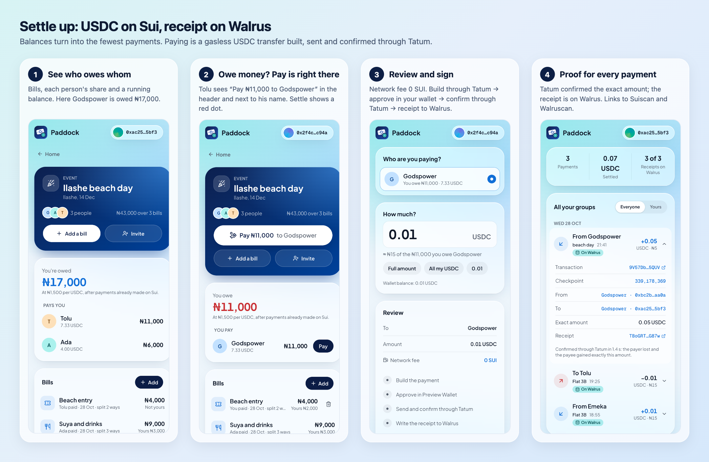
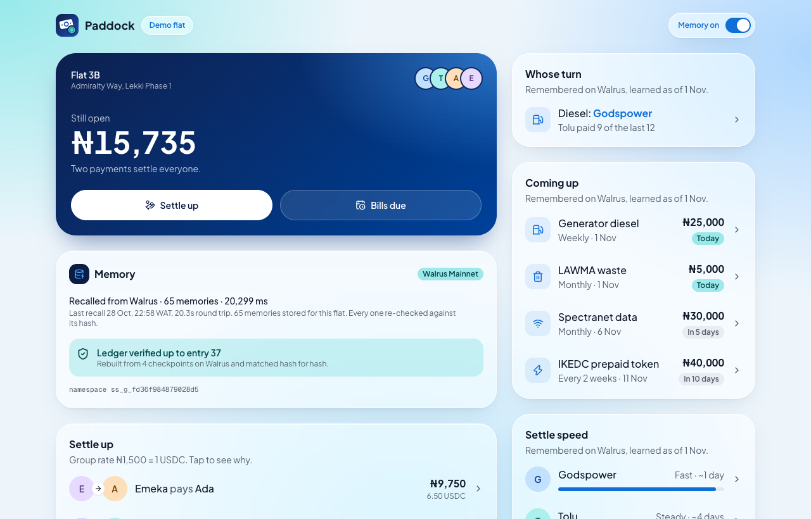
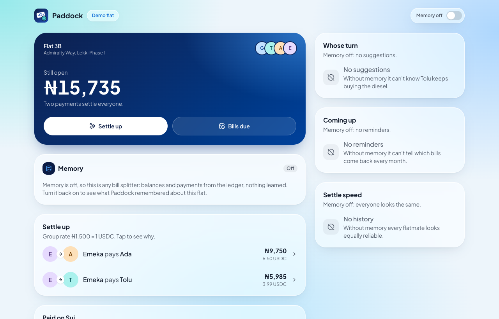
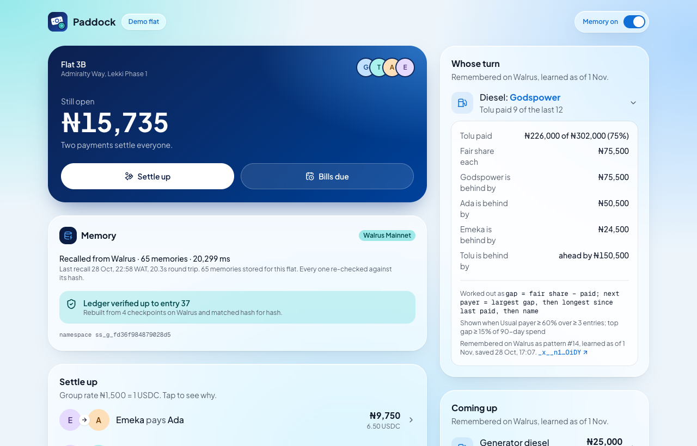
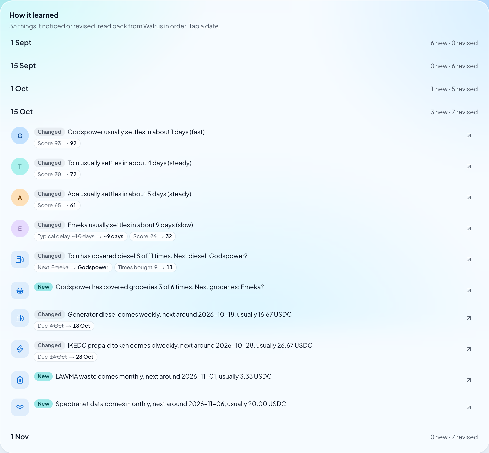
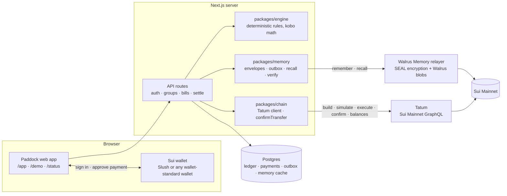
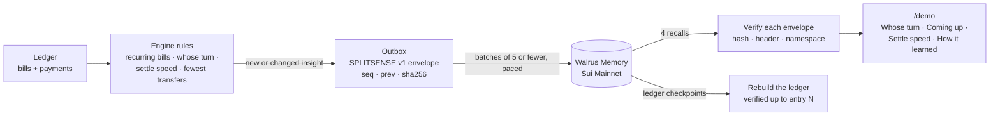
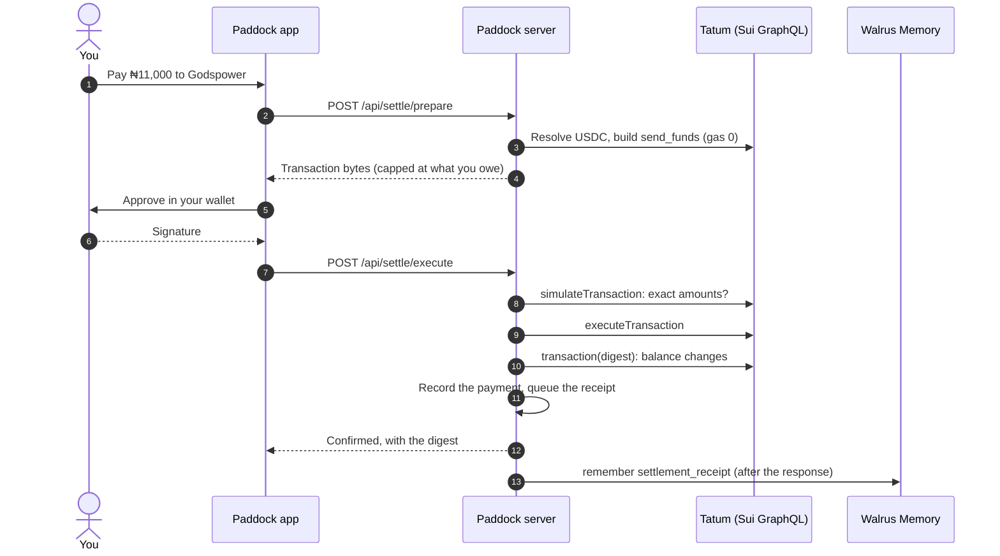
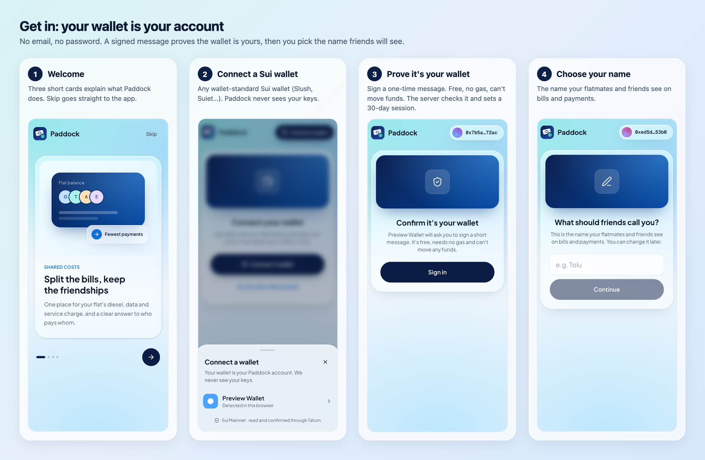
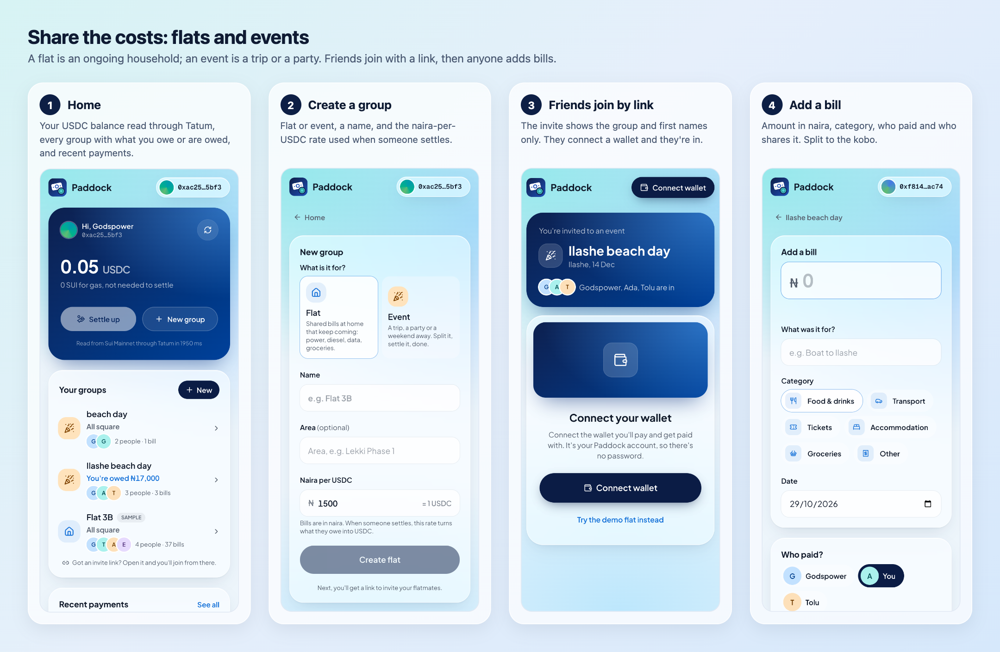

# Paddock

**The group-money app that remembers how your flat actually lives, and can prove every suggestion.**

Paddock helps flatmates and friends in Lagos share bills (diesel, prepaid power, data, groceries, trips) and settle up in USDC on Sui. Over time it learns who usually pays for what, which bills come back, and how quickly each person settles. That learned layer lives in **Walrus Memory on Sui Mainnet**. Every on-chain read and every payment goes through **Tatum**.

Built for the Tatum × Walrus **"Total Recall"** hackathon, Consumer Finance track.

| | |
|---|---|
| Live app | _link added at submission_ (open `/demo` without signing in, `/status` for live checks) |
| Video (2–3 min) | _link added at submission_ |
| Blog post | _link added at submission_ |
| Proof of every transaction and memory | [`docs/PROOF.md`](docs/PROOF.md) |



## At a glance

| What judges asked for | Result | Proof |
|---|---|---|
| Walrus Memory writes on **Mainnet** | **69 memories** in 4 namespaces, written through a paced outbox | [Memory counts](#results-and-proof) · [every blob](docs/PROOF.md#every-memory-written) |
| At least 10 memories | 69 (65 for the demo flat alone) | `pnpm proof` |
| Memory that changes the product | `/demo` renders "Whose turn", "Coming up" and "Settle speed" **from memories recalled from Walrus**. Turning memory off removes them | [Before and after](#walrus-memory-the-apps-long-term-memory) |
| Tatum for on-chain data | **3 real USDC payments** built, simulated, executed and confirmed through Tatum's Sui GraphQL, all with **0 gas**. Live reads on `/status` | [Transactions](docs/PROOF.md#2-sui-mainnet-transactions-through-tatum) |
| Clean code | Strict TypeScript, **88 unit tests**, 3 live Tatum tests, 45 group-flow checks, 9 settle checks, 12 decision records | [Tests](#results-and-proof) |

## The problem

In a shared Lagos flat the money never stops: generator diesel every week, IKEDC prepaid tokens, Spectranet data, LAWMA waste, service charge, the Shoprite run. Someone pays, someone forgets, and the argument happens in the WhatsApp group.

Split-bill apps can tell you the balance, but they forget how the flat actually lives:

- **Nobody remembers whose turn it is.** Tolu has bought the diesel 9 times out of 12, yet the app treats every bill as if it were the first.
- **Suggestions can't be checked.** If an app says "Godspower should pay next", nobody can see why, or whether the history behind it was edited.
- **Settling is awkward.** Bank transfers between friends are manual, and a crypto payment usually means gas, addresses and jargon.
- **History is locked in one app's database.** Lose the device or the account, and the group's history goes with it.

## The solution

Paddock keeps an honest ledger and adds a memory on top:

1. **It learns the flat's habits.** Fixed, versioned rules (no AI model decides anything) find recurring bills, the usual payer, whose turn is next and how quickly each person settles.
2. **It remembers them on Walrus.** Each insight is written to Walrus Memory as a signed, hash-chained envelope, and the app reads them back from Walrus to drive what you see. The timeline shows what it learned, what it revised, and what it stopped believing.
3. **It can prove every suggestion.** Tap any learned row to see the formula, the numbers, and the exact Walrus blob it came from. The ledger itself can be rebuilt from checkpoints on Walrus and checked hash for hash.
4. **It settles in USDC on Sui, with no gas.** The payment is built, executed and confirmed through Tatum. Only when Tatum confirms the exact amount does Paddock write the receipt to Walrus.

## How Tatum and Walrus make it work

### Walrus Memory: the app's long-term memory

**What gets remembered.** There are five kinds of memory, each a `SPLITSENSE v1` envelope (one header line, then canonical JSON with `seq`, `prev` and `sha256` hash):

| Kind | Example | Written when |
|---|---|---|
| `pattern_snapshot` | "Tolu has covered diesel 9 of 12 times. Next diesel: Godspower?" | A rule's output changes |
| `member_habit` | "Emeka usually settles in about 9 days (slow)" | Someone's settle speed changes |
| `ledger_checkpoint` | Entries 31–37 with a cumulative ledger hash | Every 10 ledger entries |
| `group_profile` | Members and the group's naira-per-USDC rate | The group is set up |
| `settlement_receipt` | 0.01 USDC Emeka → Godspower, confirmed by Tatum at checkpoint 339,135,513 | Tatum confirms a payment |

**How it's written.** Drafts go into a Postgres outbox that dedupes by content hash. The outbox is drained in batches of at most 5 to stay under the relayer's rate limit, and the job and blob IDs are recorded. Older knowledge is never written after newer knowledge.

**How it's read back.** Four recalls (one per kind) fetch the group's memories from Walrus. Every envelope is re-checked (hash, header, namespace), and anything that fails is rejected. The demo renders from that verified set, refreshed in the background so a 20-second recall never blocks the page. If Walrus doesn't answer, the page says it's using cached memory and when it last heard from Walrus.

**What it changes.** Memory on (left) and memory off (right). With memory off, Paddock is a plain bill splitter: same balances, no suggestions.

<table>
<tr>
<td></td>
<td></td>
</tr>
<tr>
<td><b>Memory on.</b> "Recalled from Walrus · 65 memories". Ledger verified up to entry 37. Whose turn, Coming up and Settle speed all come from memory.</td>
<td><b>Memory off.</b> The same balances, but it can't know Tolu keeps buying the diesel or which bills come back.</td>
</tr>
</table>

**Every suggestion shows its working and its memory.** Opening "Diesel: Godspower" shows the numbers, the formula, and "Remembered on Walrus as pattern #14", linked to [its blob on Walruscan](https://walruscan.com/mainnet/blob/_x__n1nD3gleY_ZQduTJtcNYmFIhPUg7R0H3A4yOiDY):



**How it learned over time.** The timeline is read back from Walrus in order: 35 changes between 1 Sep and 1 Nov, with before and after values. On 1 Nov the groceries rotation stopped holding, and that **forgetting** was written to Walrus as a memory too.



**Privacy.** Namespaces are `ss_g_` plus 16 hex characters of `sha256(groupId + salt)`, so no names appear in public metadata. The relayer encrypts each memory with SEAL before it becomes a Walrus blob.

### Tatum: every on-chain read and write

All Sui access goes through one small package, `packages/chain`, which talks to Tatum's **Sui Mainnet GraphQL** gateway (`sui-mainnet.gateway.tatum.io`) from the server only.

| Used for | Tatum GraphQL |
|---|---|
| Wallet balances on Home | `address.balance(coinType)` for USDC and SUI |
| Building a payment | `SuiGraphQLClient` at Tatum: resolves the payer's USDC and builds `0x2::balance::send_funds<USDC>` with gas price 0 |
| Checking it before sending | `simulateTransaction`: the payer must lose, and the payee gain, exactly the agreed amount |
| Sending it | `executeTransaction` |
| Confirming it | `transaction(digest) { effects { status balanceChanges } }`: exact `−amount` and `+amount` in USDC, or no receipt |
| `/status` | Chain identifier (asserted Sui Mainnet), latest checkpoint, a known transaction's balance changes, a USDC balance |

The client spaces every request for Tatum's free plan (3 requests per second), retries 429, 5xx and timeouts with backoff and jitter, honours `Retry-After`, and returns typed `ok`/`error` results instead of throwing. The Sui SDK's own parallel calls go through the same queue.


## Results and proof

`pnpm proof` re-confirms each payment through Tatum and counts the memories on Walrus:


| Sui Mainnet transaction | Payment | Gas | Receipt on Walrus |
|---|---|---|---|
| [`FHS5aw5nn9X4DKRevpoTKs4yMGhUnHEsgT725THiuAU2`](https://suiscan.xyz/mainnet/tx/FHS5aw5nn9X4DKRevpoTKs4yMGhUnHEsgT725THiuAU2) | 0.01 USDC, Emeka → Godspower (first gasless test) | 0 SUI | [`2mnwqBb4M-…`](https://walruscan.com/mainnet/blob/2mnwqBb4M-kSmnUU8qhrV9mqi7cRLaO_-fmfxsapY0U) |
| [`Eu7yRGabs6aHsM7pERoULg3HnfM9zZuYRnUNmaNSiXwc`](https://suiscan.xyz/mainnet/tx/Eu7yRGabs6aHsM7pERoULg3HnfM9zZuYRnUNmaNSiXwc) | 0.01 USDC, Godspower → Tolu (through the app's settle API) | 0 SUI | [`AhdHmgZ9mq…`](https://walruscan.com/mainnet/blob/AhdHmgZ9mqssiPHcqBoiSgfZNIfP7XmSmHokRU8lJoI) |
| [`9V57Dbu95yuikVhYysxreSg7vFL3PxFqzNJMgQkV5QUV`](https://suiscan.xyz/mainnet/tx/9V57Dbu95yuikVhYysxreSg7vFL3PxFqzNJMgQkV5QUV) | 0.05 USDC in a user-created group (signed in a browser wallet at `/app/settle`) | 0 SUI | [`TBoGRTytpS…`](https://walruscan.com/mainnet/blob/TBoGRTytpSzQcizzvMydeIY3IB4q1WzvGW3XSlGG87w) |

| Walrus namespace | Memories |
|---|---|
| `ss_g_fd36f984879028d5` (Flat 3B demo: profile, 4 checkpoints, 5 rounds of learning, 2 receipts) | 65 |
| `ss_g_37a6c1efd43850de` (first round trip) | 2 |
| `ss_g_890a18bd94e3e136` (a group created in the app) | 1 |
| `ss_app` (first Mainnet memory) | 1 |
| **Total on Mainnet** | **69** |

Reading it back: 65 recalled, **65 verified, 0 rejected**, and the ledger rebuilt from Walrus checkpoints matches **37 of 37** entries.


Tests and checks:


<details>
<summary>Settle API refusals and the group-flow run</summary>


</details>

Every transaction, every memory blob (with Walruscan links), and Suiscan and Walruscan screenshots are in **[`docs/PROOF.md`](docs/PROOF.md)**.

## Architecture



**The ledger lives in Postgres; the learned layer lives in Walrus.** Bills and payments need fast, exact reads, so they stay in Postgres. What the app *learned* from them is written to Walrus Memory and read back from there, so it's portable, tamper-evident and visible to the user ([ADR-0005](docs/adr/0005-ledger-in-postgres-learned-layer-in-walrus.md)).

### The memory loop



### A payment, end to end



### Sign-in

There is no email or password: **the wallet is the account** ([ADR-0012](docs/adr/0012-wallet-is-identity.md)). The server issues a one-time challenge, the wallet signs it (`sui:signPersonalMessage`, free and gasless), and the server verifies the signature and sets an HttpOnly session cookie signed with HMAC-SHA256.

### Repository layout

```text
apps/web               Next.js 16 app: screens, API routes, server modules
  src/app/app          the signed-in app: home, groups, add bill, settle, activity, join
  src/app/demo         judge mode: the seeded Flat 3B, read-only, no sign-in
  src/app/status       live Tatum and Walrus checks
  src/server           groups, sessions, settlement, memory publishing
packages/engine        pure rules and money math (integer kobo, largest-remainder splits)
packages/memory        envelopes, hash chain, outbox, recall, verification, ledger rebuild
packages/chain         the only Tatum client: queue, retries, reads, transfer build, confirmTransfer
fixtures               the Flat 3B ledger used by /demo and the golden tests
scripts                proof, seeding, smoke tests, end-to-end runs, screenshots
docs                   proof, spec, decision records, evidence, screenshots
```

The code keeps the project's codename, SplitSense: packages are `@splitsense/*`, and memories use the `SPLITSENSE v1` envelope that is already stored on Mainnet.

**Stack:** Next.js 16 (App Router), React 19, TypeScript (strict), Tailwind CSS, Drizzle ORM on Postgres (Neon), `@mysten/sui` 2.38, `@mysten-incubation/memwal` 0.1.8, zod, Vitest.

## The app, step by step






**Judge mode (`/demo`)** opens Flat 3B, a seeded flat with 37 bills from 1 Aug to 28 Oct, with no wallet needed. It has the memory switch, the "Why?" panels, the timeline and the ledger check.

## Run it locally

```bash
pnpm install
cp .env.example .env.local      # fill in Tatum, Walrus Memory, Postgres and SESSION_SECRET
pnpm db:migrate
pnpm dev                        # http://localhost:3000

pnpm test                       # engine, memory and chain unit tests (offline)
pnpm test:live                  # the Tatum reads /status makes, against Mainnet
pnpm proof                      # re-confirm every settlement through Tatum; count memories on Walrus
pnpm memory:health              # relayer health, delegate key check, memories per namespace
pnpm memory:refresh             # recall Flat 3B from Walrus, verify every envelope and the ledger
pnpm seed:mainnet --dry-run     # what the seed would write, phase by phase (idempotent when run)
pnpm settle:smoke               # build and simulate a 0.01 USDC gasless transfer through Tatum
pnpm settle:api                 # attack the settle API (needs the app running); --send pays for real
pnpm groups:e2e                 # three wallets: sign in, create, invite, join, add bills, balances
```

`MEMORY_USER_GROUPS=on` also writes receipts for groups people create in the app. Secrets stay in `.env.local`, which git ignores. The Tatum key and the memory key are only used on the server.

## Honest limits

- The demo flat's people and bills are synthetic. The wallets, transactions and memories are real Mainnet objects.
- For groups created in the app, Walrus currently stores the payment receipts. Their "Spotted in your bills" tips are computed from the ledger each time rather than read from memory.
- A full recall from the relayer takes about 20 seconds, so the app renders from a verified cache and refreshes in the background. It never blocks a page on Walrus.

## Docs and resources for judges

| Document | What's in it |
|---|---|
| [`docs/PROOF.md`](docs/PROOF.md) | **Start here.** Every Sui transaction and every Walrus memory with explorer links, screenshots and test runs |
| [`docs/JUDGE-GATES.md`](docs/JUDGE-GATES.md) | Each production step, what it had to prove, and the evidence recorded when it passed |
| [`docs/SPEC.md`](docs/SPEC.md) | The build spec: rules R0–R11, memory kinds, the worked example the tests check |
| [`docs/adr/`](docs/adr/README.md) | 12 architecture decisions, e.g. deterministic rules (0002), hashed namespaces (0003), Tatum GraphQL only (0004), Walrus learned layer (0005), paced outbox (0007), gasless USDC (0008), wallet as identity (0012) |
| [`PRODUCT.md`](PRODUCT.md) | Users, positioning, principles and brand |
| [`docs/evidence/`](docs/evidence) | Raw JSON from the Mainnet round trip, the seed and the `/status` checks |
| [`docs/screens/`](docs/screens) | Every screenshot used here, mobile and desktop |
| [`RESOURCES.md`](RESOURCES.md) | Every Tatum, Walrus Memory, Sui and hackathon link used while building |

External references:

- Tatum Sui RPC and GraphQL: [docs.tatum.io](https://docs.tatum.io) · gateway `https://sui-mainnet.gateway.tatum.io`
- Walrus Memory: [docs.wal.app/walrus-memory](https://docs.wal.app/walrus-memory) · [memory.walrus.xyz](https://memory.walrus.xyz) · [MemWal on GitHub](https://github.com/MystenLabs/MemWal)
- Explorers: [Suiscan](https://suiscan.xyz/mainnet) · [Walruscan](https://walruscan.com/mainnet)
- The hackathon: [Total Recall event site](https://recall-tatum-walrus.vercel.app) · [rules](https://thewalrussessions.wal.app/tatum-total-recall/index.html)
