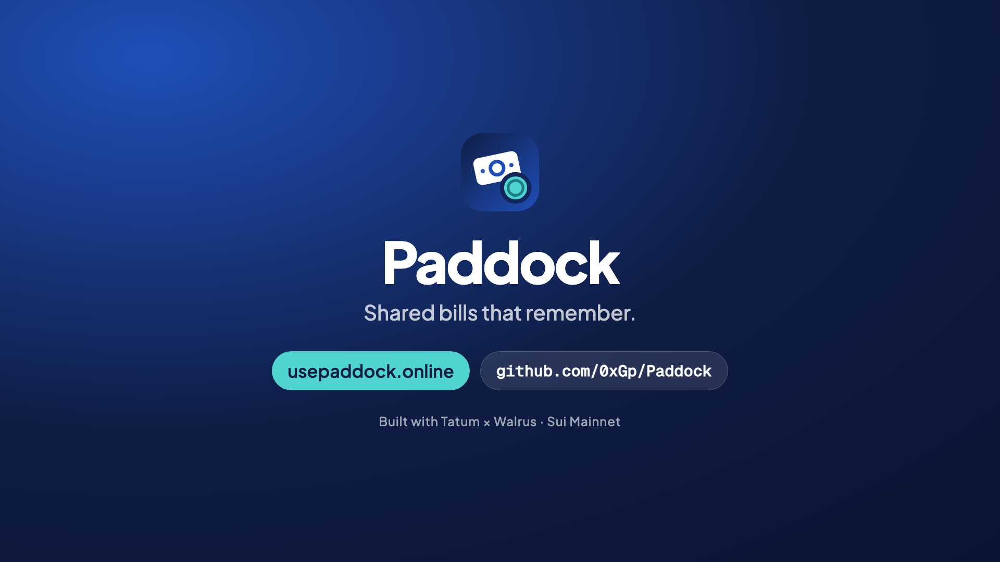
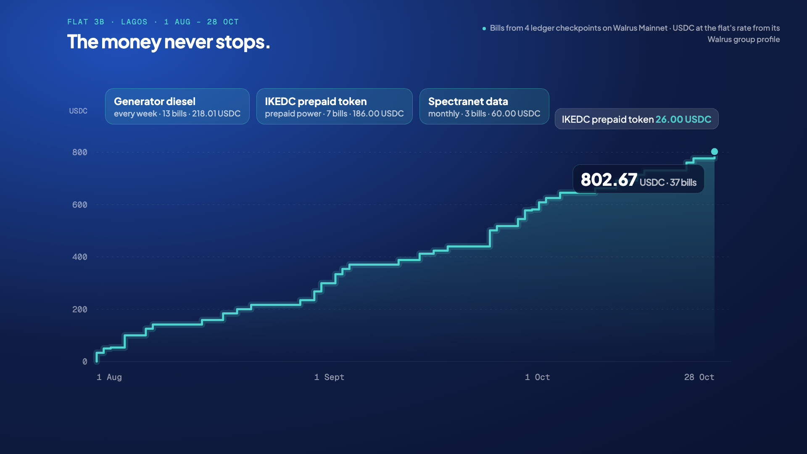
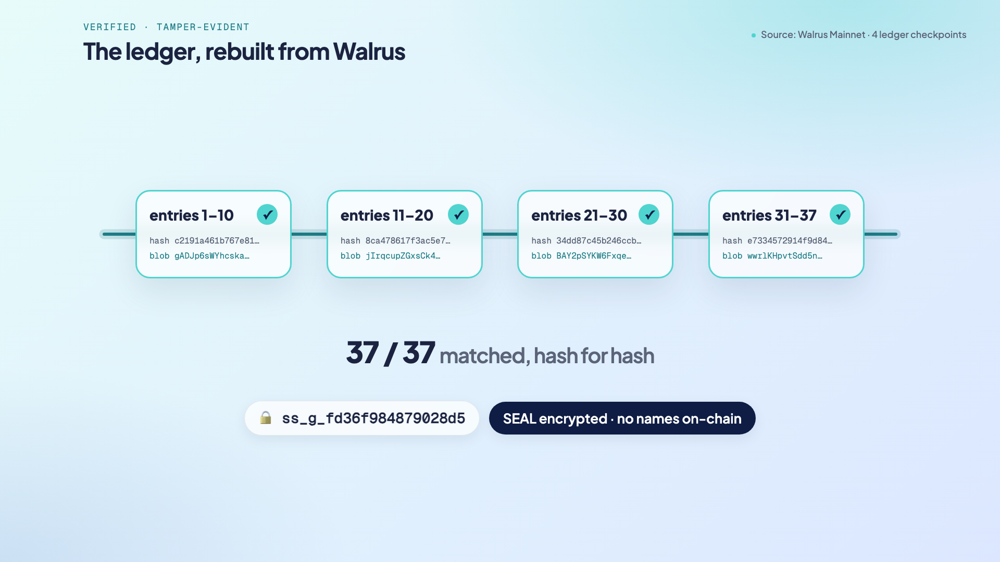
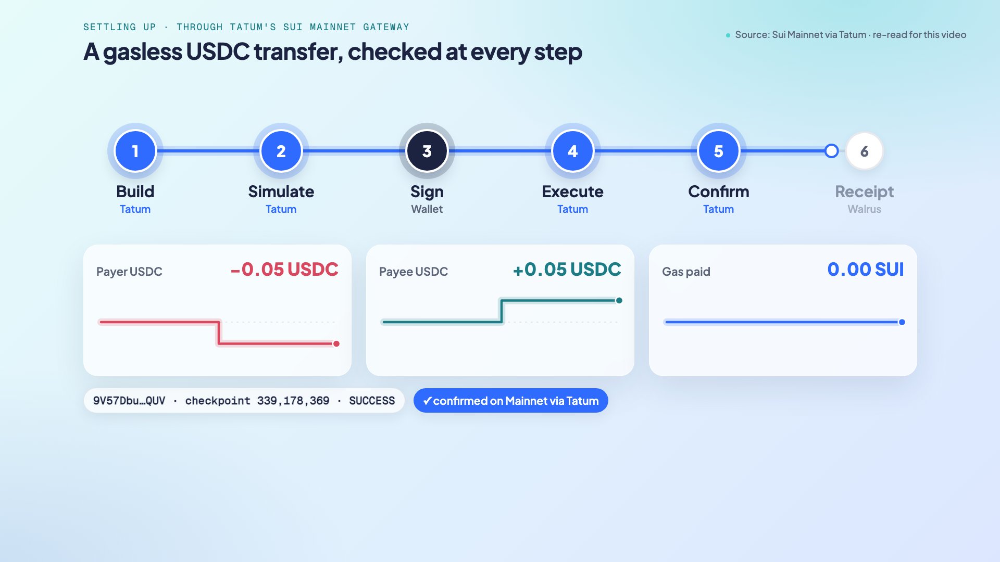
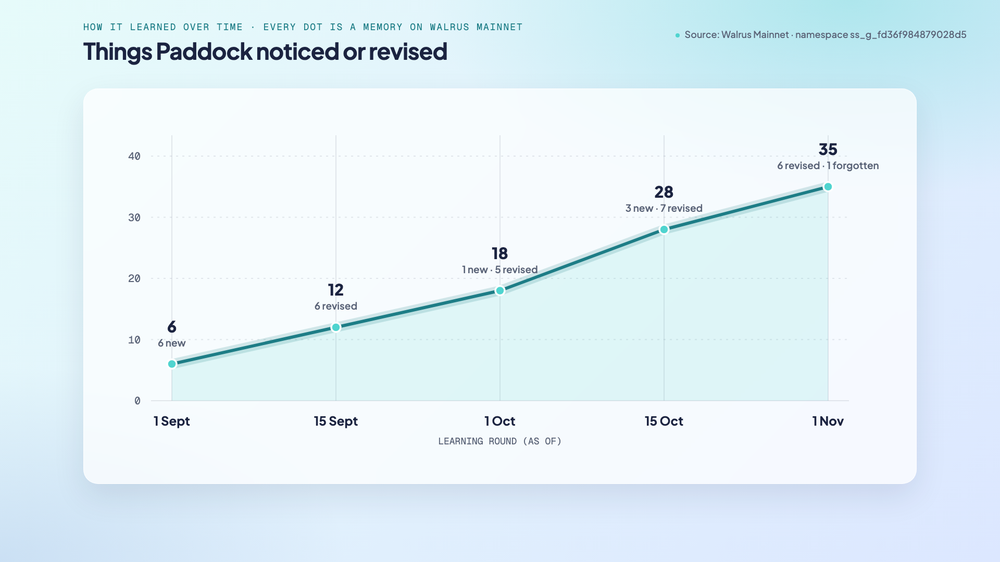
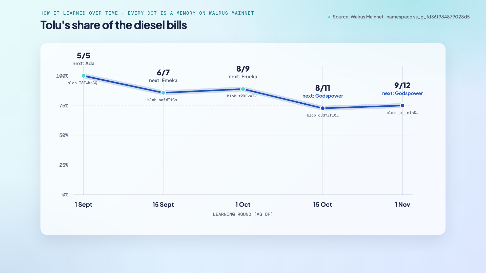
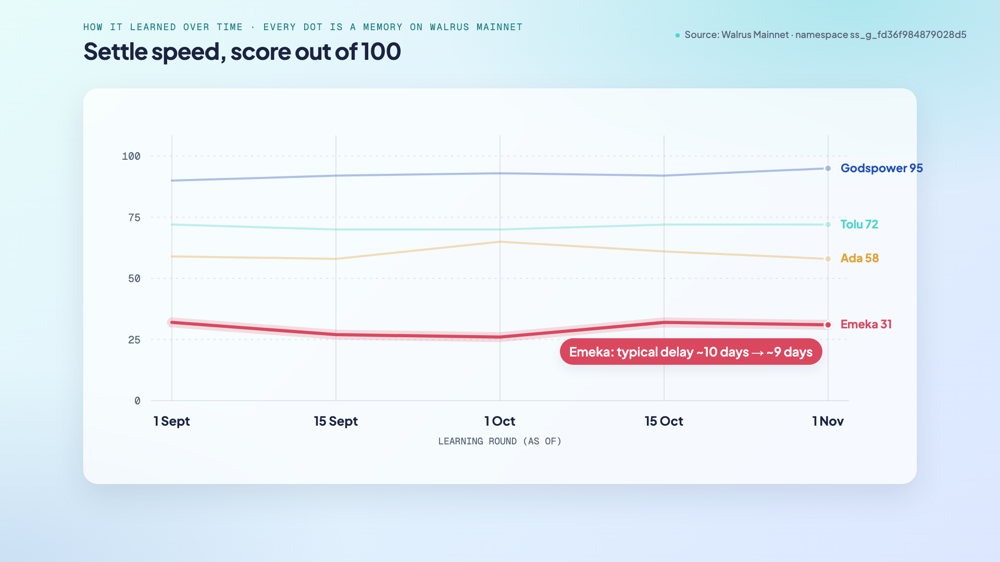
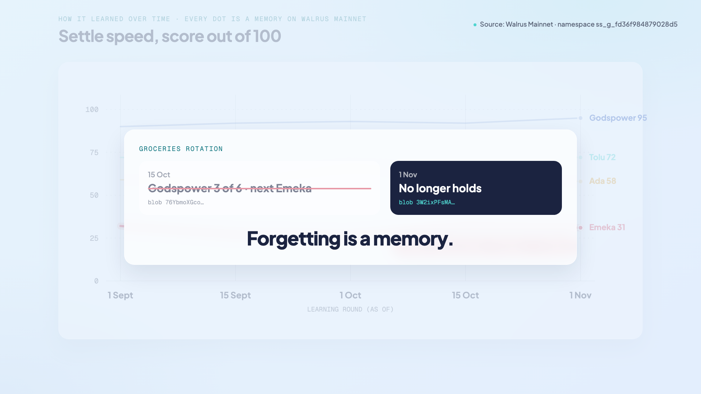

# Paddock: shared bills that remember how your flat actually lives

*Built for the Tatum × Walrus "Total Recall" hackathon, Consumer Finance track. Try it at [usepaddock.online](https://usepaddock.online).*

In a shared flat in Lagos, the money never stops. Generator diesel every week. IKEDC prepaid tokens. Spectranet data. LAWMA waste. Service charge. The Shoprite run. Someone pays, someone forgets, and the argument starts in the WhatsApp group: "who bought diesel last??"

Split-bill apps can tell you the balance. What they can't tell you is how your flat actually lives: whose turn it is, which bills are about to come back, who always pays late. Every bill is treated like the first one.

I built **Paddock** to fix that. It's a shared-bills app that learns the flat's habits, keeps what it learned in **Walrus Memory on Sui Mainnet**, can prove every suggestion it makes, and settles up in **USDC through Tatum, with zero gas**.

## What Paddock does

Paddock keeps an honest ledger of bills and payments, then adds a memory on top.

**It learns the flat's habits.** Fixed, versioned rules find the bills that come back (and how often), who usually pays for what, whose turn is next, and how quickly each person settles. No AI model decides anything, so the same history always gives the same answer.

**It remembers them on Walrus.** Every insight is written to Walrus Memory, and the app reads it back from Walrus to decide what you see. Turn the memory switch off and Paddock becomes a plain bill splitter: same balances, no suggestions. It can't know that Tolu keeps buying the diesel.

**It can prove every suggestion.** Tap "Diesel: Godspower" and you see the working: Tolu paid 9 of the last 12 diesel bills, everyone's fair share, the formula that picks the next payer, and a link to [the exact Walrus blob](https://walruscan.com/mainnet/blob/_x__n1nD3gleY_ZQduTJtcNYmFIhPUg7R0H3A4yOiDY) the suggestion came from.

**It settles in USDC, with no gas.** Pay a flatmate from a Sui wallet. You never need SUI for fees, and the receipt is stored on Walrus once the payment is confirmed.

Judges and readers can try all of this without signing in at [usepaddock.online/demo](https://usepaddock.online/demo). It opens Flat 3B, a demo flat with four flatmates (Godspower, Tolu, Ada and Emeka) and 37 bills from 1 August to 28 October. The people and bills are made up; the memories, blobs and payments are real Mainnet objects.

## How Paddock uses Walrus Memory

Walrus Memory is Paddock's long-term memory. The ledger (bills and payments) stays in Postgres, because money needs fast, exact reads. What the app **learned** from the ledger lives on Walrus, so it's portable, tamper-evident and visible to the user.

**What gets remembered.** Five kinds of memory:

- **Patterns:** "Tolu has covered diesel 9 of 12 times. Next diesel: Godspower?"
- **Habits:** "Emeka usually settles in about 9 days (slow)"
- **Ledger checkpoints:** every 10 entries, with a running hash of the whole ledger
- **The group profile:** the members and the group's rate for converting bills to USDC
- **Payment receipts:** written only after a payment is confirmed on-chain

**Every memory can be checked.** Each one is a small signed envelope: a header line, then canonical JSON with a sequence number, a link to the previous memory and a SHA-256 hash. When Paddock reads memories back, it re-checks every envelope and rejects anything that doesn't match. On the last run, **65 memories were recalled, 65 verified, 0 rejected**.

**The ledger can be rebuilt from Walrus.** Paddock rebuilds the ledger from its four checkpoints on Walrus and compares it with the database, hash for hash. All **37 of 37 entries** match.

**Writing politely.** New memories go into an outbox that removes duplicates and sends at most five at a time, so Paddock stays inside the relayer's rate limits. Older knowledge is never written after newer knowledge.

**Privacy.** Group namespaces are hashed (Flat 3B is `ss_g_fd36f984879028d5`), so no names appear in public metadata. The Walrus Memory relayer encrypts each memory with SEAL before it becomes a blob.

**Reading never blocks the page.** A full recall takes around 20 seconds, so the app renders from a verified copy and refreshes from Walrus in the background. If Walrus is slow, the page says when it last heard from it.

## How Paddock uses Tatum

Every on-chain read and every payment goes through **Tatum's Sui Mainnet GraphQL gateway**, from the server only.

A payment runs through six steps:

1. **Build:** Tatum resolves the payer's USDC, and Paddock builds a gasless USDC transfer.
2. **Simulate:** through Tatum, Paddock checks that the payer loses, and the payee gains, exactly the agreed amount. Anything else is refused.
3. **Sign:** the user approves it in their own wallet.
4. **Execute:** Tatum submits the transaction.
5. **Confirm:** Tatum reads back the balance changes. Only an exact match counts.
6. **Receipt:** only then does the receipt go to Walrus.

Three real USDC payments have gone through this pipeline on Sui Mainnet, **all with 0 SUI gas**. The third, [9V57Dbu…QUV](https://suiscan.xyz/mainnet/tx/9V57Dbu95yuikVhYysxreSg7vFL3PxFqzNJMgQkV5QUV), was signed in a browser wallet in the app and confirmed at checkpoint 339,178,369.

Tatum also powers the wallet balances on the home screen and a public [status page](https://usepaddock.online/status). It calls Tatum live and shows the chain, the latest checkpoint, a known transaction's balance changes and a USDC balance, each with its latency. The client spaces requests to fit Tatum's free plan, retries rate limits and timeouts with backoff, and never throws errors into the UI.

## How it learned over time

This is the part I'm proudest of. Paddock doesn't learn once. It re-runs its rules in **rounds**, compares the result with what it remembered last time, and writes only what changed: something new, something revised, or something it no longer believes.

Flat 3B's three months of bills were replayed in five learning rounds (1 Sep, 15 Sep, 1 Oct, 15 Oct and 1 Nov). Every point on these charts is a memory on Walrus Mainnet, with its own blob ID.

**The learning curve.** Six things noticed in the first round. Six revised in the second. By the fifth round, 35 changes in total: new patterns, revised habits, and one thing forgotten.

**Whose turn for diesel.** In the first round, Tolu had paid for diesel 5 times out of 5, and Paddock suggested Ada go next. As more bills came in, Tolu's share moved to 6 of 7, then 8 of 9, then 8 of 11. By 15 October, Godspower was furthest behind on diesel, so the suggestion moved to him, and it held at 9 of 12 on 1 November.

**Recurring bills, getting more certain.** Paddock first spotted generator diesel as a weekly bill with 80% confidence. Two weeks later it was 96%, and 97% by mid-October. IKEDC prepaid power showed up as a fortnightly bill on 1 October (79%) and reached 94% two weeks later.

**Settle speed.** Each flatmate's habit is scored out of 100. Godspower settles fast and climbed from 90 to 95. Emeka is the slow one: his typical delay was about 10 days for the first three rounds, then improved to about 9 days on 15 October, and the memory was revised to say so.

**Forgetting is a memory too.** On 15 October, Paddock noticed a groceries rotation: Godspower had covered 3 of 6 grocery runs, so Emeka should go next. By 1 November the pattern no longer held, so Paddock retired it and wrote that down on Walrus too. The timeline in the app shows it as "Stopped", with before and after values. Most apps silently drop what's no longer true. Paddock keeps a record of changing its mind.

All of this is visible in the app under **How it learned**, read back from Walrus in order.

## The results

- **69 memories on Walrus Mainnet** across 4 namespaces (65 for the demo flat alone). The requirement is 10.
- **65 of 65** memories verified on read-back, 0 rejected.
- **37 of 37** ledger entries rebuilt from Walrus, hash for hash.
- **3 USDC payments** on Sui Mainnet through Tatum, **0 gas**.
- **88 unit tests**, live Tatum tests, and 12 written architecture decisions.

## What I learned building it

- **Make memory visible, or nobody believes it's there.** The memory switch and the "Why?" panels turned memory from an implementation detail into the product.
- **Deterministic beats clever for money.** Friends will accept "Tolu paid 9 of the last 12" much more readily than "the AI thinks".
- **Plan for slow reads.** A 20-second recall is fine if the page renders from a verified copy and refreshes in the background.
- **Confirm, then remember.** Writing the receipt only after Tatum confirms the exact balance change means the memory never records a payment that didn't happen.

## What's next

- Habits that follow you from one group to the next (your settle speed shouldn't reset when you join a new trip group).
- Learned suggestions for every group created in the app, not just the demo flat.
- A naira on-ramp, so paying a flatmate in USDC feels as normal as a bank transfer.

## Try it

- Live app: [usepaddock.online](https://usepaddock.online) (open [/demo](https://usepaddock.online/demo) without signing in)
- Live Tatum and Walrus checks: [usepaddock.online/status](https://usepaddock.online/status)
- Code: [github.com/0xGp/Paddock](https://github.com/0xGp/Paddock)
- Every transaction and memory, with explorer links: [PROOF.md](https://github.com/0xGp/Paddock/blob/main/docs/PROOF.md)
- Demo video (3 min): [youtu.be/kbsOv2sbv6k](https://youtu.be/kbsOv2sbv6k)

Thanks to Tatum and the Walrus Foundation for running Total Recall.

#Walrus #Tatum #Sui #Web3 #Fintech #BuildInPublic #Hackathon #Lagos

---

## Post to share the article (LinkedIn feed)

> In a shared flat in Lagos, the money never stops: diesel every week, prepaid power, data. Someone pays, someone forgets, and the argument starts in the group chat.
>
> So I built Paddock for the Tatum × Walrus "Total Recall" hackathon: shared bills that remember.
>
> 🧠 It learns whose turn it is, which bills come back and who settles late, and keeps it in Walrus Memory on Sui Mainnet (69 memories, every one verifiable).
> 🔍 Every suggestion shows its working and links to the exact Walrus blob it came from.
> 💸 Settle up in USDC through Tatum, with zero gas.
>
> The full story, including how it learned over time, is in the article. Watch the 3-minute demo: youtu.be/kbsOv2sbv6k. Try it without signing in: usepaddock.online/demo
>
> Tag: Tatum, Walrus Foundation
>
> #Walrus #Tatum #Sui #Fintech #BuildInPublic
