# On-chain proof: every Tatum call and Walrus write

This page lists everything Paddock has done on Sui Mainnet: each USDC transaction (built, sent and confirmed through **Tatum**) and each memory written to **Walrus Memory**, with explorer links and screenshots. All checks below were re-run on **28 Oct 2026 at about 21:55 WAT** (UTC+1).

The demo flat "Flat 3B" and its people (Godspower, Tolu, Ada, Emeka) are synthetic. The wallets and the money are real.

## 1. Check it yourself in two minutes

`pnpm proof` (read-only) re-reads every settlement through Tatum and requires the exact USDC amount to have left the payer and reached the payee. It then asks the Walrus Memory relayer how many memories each namespace holds.

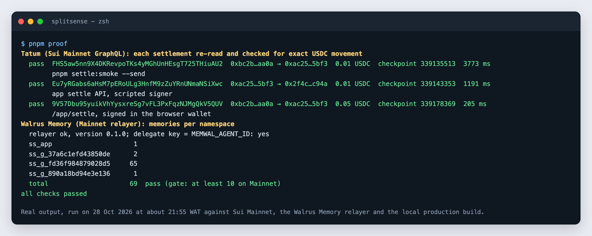

Without cloning anything, open these:

| Check | Link |
|---|---|
| A payment signed in a browser wallet through the app | [Suiscan `9V57Dbu9…`](https://suiscan.xyz/mainnet/tx/9V57Dbu95yuikVhYysxreSg7vFL3PxFqzNJMgQkV5QUV) |
| Its receipt, stored on Walrus | [Walruscan `TBoGRTyt…`](https://walruscan.com/mainnet/blob/TBoGRTytpSzQcizzvMydeIY3IB4q1WzvGW3XSlGG87w) |
| A learned memory the demo shows ("Next diesel: Godspower") | [Walruscan `_x__n1nD…`](https://walruscan.com/mainnet/blob/_x__n1nD3gleY_ZQduTJtcNYmFIhPUg7R0H3A4yOiDY) |
| Live Tatum and Walrus checks | `/status` on the deployed app |

## 2. Sui Mainnet transactions, through Tatum

### The three settlements

| # | When (WAT) | Payment | Transaction | Gas | Checkpoint | How it was signed | Receipt on Walrus |
|---|---|---|---|---|---|---|---|
| 1 | 28 Oct, 18:55 | Emeka → Godspower, **0.01 USDC** (₦15, Flat 3B) | [`FHS5aw5nn9X4DKRevpoTKs4yMGhUnHEsgT725THiuAU2`](https://suiscan.xyz/mainnet/tx/FHS5aw5nn9X4DKRevpoTKs4yMGhUnHEsgT725THiuAU2) | 0 SUI | 339,135,513 | `pnpm settle:smoke --send` (first gasless test) | [`2mnwqBb4M-…`](https://walruscan.com/mainnet/blob/2mnwqBb4M-kSmnUU8qhrV9mqi7cRLaO_-fmfxsapY0U) |
| 2 | 28 Oct, 19:25 | Godspower → Tolu, **0.01 USDC** (₦15, Flat 3B) | [`Eu7yRGabs6aHsM7pERoULg3HnfM9zZuYRnUNmaNSiXwc`](https://suiscan.xyz/mainnet/tx/Eu7yRGabs6aHsM7pERoULg3HnfM9zZuYRnUNmaNSiXwc) | 0 SUI | 339,143,353 | The app's settle API, with a script signing in place of the wallet | [`AhdHmgZ9mq…`](https://walruscan.com/mainnet/blob/AhdHmgZ9mqssiPHcqBoiSgfZNIfP7XmSmHokRU8lJoI) |
| 3 | 28 Oct, 21:41 | Member → member, **0.05 USDC** (a user-created event group) | [`9V57Dbu95yuikVhYysxreSg7vFL3PxFqzNJMgQkV5QUV`](https://suiscan.xyz/mainnet/tx/9V57Dbu95yuikVhYysxreSg7vFL3PxFqzNJMgQkV5QUV) | 0 SUI | 339,178,369 | `/app/settle`, approved in a browser wallet | [`TBoGRTytpS…`](https://walruscan.com/mainnet/blob/TBoGRTytpSzQcizzvMydeIY3IB4q1WzvGW3XSlGG87w) |

Wallets involved (demo wallets created for this hackathon):

| Who | Sui address |
|---|---|
| Emeka (payer) | [`0xbc2b335934bb904f0cdce60564844bae509ac81b581fa8330298762d56edaa0a`](https://suiscan.xyz/mainnet/account/0xbc2b335934bb904f0cdce60564844bae509ac81b581fa8330298762d56edaa0a) |
| Godspower | [`0xac250d52d9dc6456d0c444f1b0a2e20347127f8ad6a18a7a8dbcb8904e4d5bf3`](https://suiscan.xyz/mainnet/account/0xac250d52d9dc6456d0c444f1b0a2e20347127f8ad6a18a7a8dbcb8904e4d5bf3) |
| Tolu | [`0x2f4c5924de9bfd2b0f4a8cf607c7cb3363ade46f5bc2bc50a4965481ede3c94a`](https://suiscan.xyz/mainnet/account/0x2f4c5924de9bfd2b0f4a8cf607c7cb3363ade46f5bc2bc50a4965481ede3c94a) |

The payer was funded by bridging 0.000544 ETH from Ethereum with Mayan ([`0xda8276b3…d27c`](https://etherscan.io/tx/0xda8276b398dd80340fbcbef6fadf28471c92fffd86e9858d852597ec37fed27c)), which arrived as 1.20 native USDC and 0.05 SUI. That SUI has never been spent: every payment above paid **0 gas**.

### What Tatum does in each payment

Every step runs against Tatum's Sui Mainnet GraphQL gateway (`sui-mainnet.gateway.tatum.io`) from the server. The API key never reaches the browser.

| Step | Tatum GraphQL call | What Paddock checks |
|---|---|---|
| 1. Build | `SuiGraphQLClient` pointed at Tatum resolves the payer's USDC and builds `0x2::balance::send_funds<USDC>` with gas price 0 and budget 0 | The amount is at least 0.01 USDC and no more than you owe that person |
| 2. Sign | (in the user's wallet, `sui:signTransaction`) | Nothing leaves the browser except the signature |
| 3. Simulate | `simulateTransaction` with balance changes | The signer is your connected wallet and the signature matches. The payer loses, and the payee gains, exactly the agreed amount |
| 4. Execute | `executeTransaction` | Status `SUCCESS` |
| 5. Confirm | `transaction(digest) { effects { status balanceChanges } }`, polled for up to 15 s | Exactly `−amount` for the payer and `+amount` for the payee, in USDC (`confirmTransfer`, 10 unit tests) |
| 6. Remember | – | Only after step 5: the payment is recorded and its `settlement_receipt` is queued for Walrus |

`pnpm settle:api` attacks this pipeline and checks that 8 kinds of bad request are refused before anything reaches the chain:

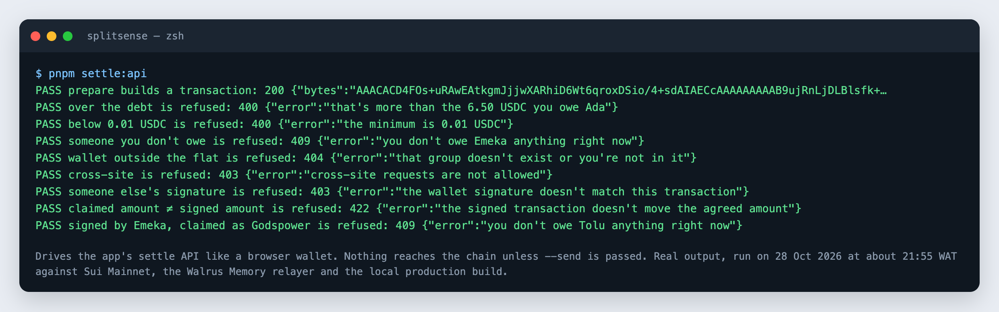

### On Suiscan

The browser-wallet payment (#3). Note **Total Gas Fee 0 SUI**:

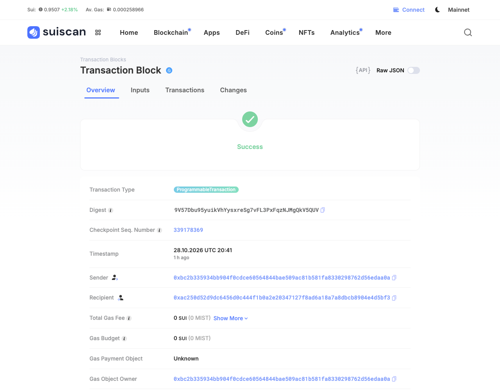

<details>
<summary>The other two payments on Suiscan</summary>

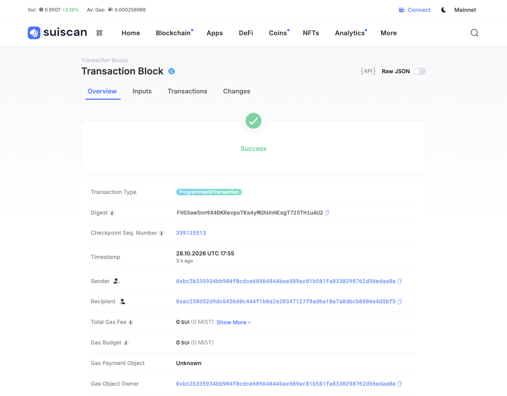

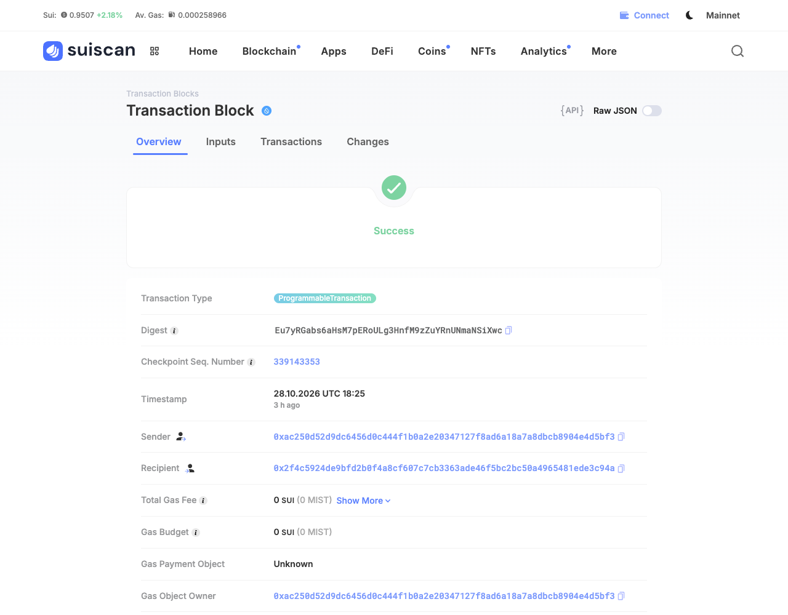

</details>

### Tatum reads on `/status`

`/status` makes three live Tatum calls, plus two Walrus relayer calls, and shows the query, the result and the latency of each. Tatum returns the chain identifier (asserted to be Sui Mainnet) with the latest checkpoint, the balance changes of settlement #1, and a USDC balance. All Tatum traffic goes through one queue spaced for the free plan (3 requests per second), with timeouts and retries on 429 and 5xx. The page is cached for 30 s, so 80 parallel visitors cost one round of calls ([`evidence/brick4-status.json`](evidence/brick4-status.json)).

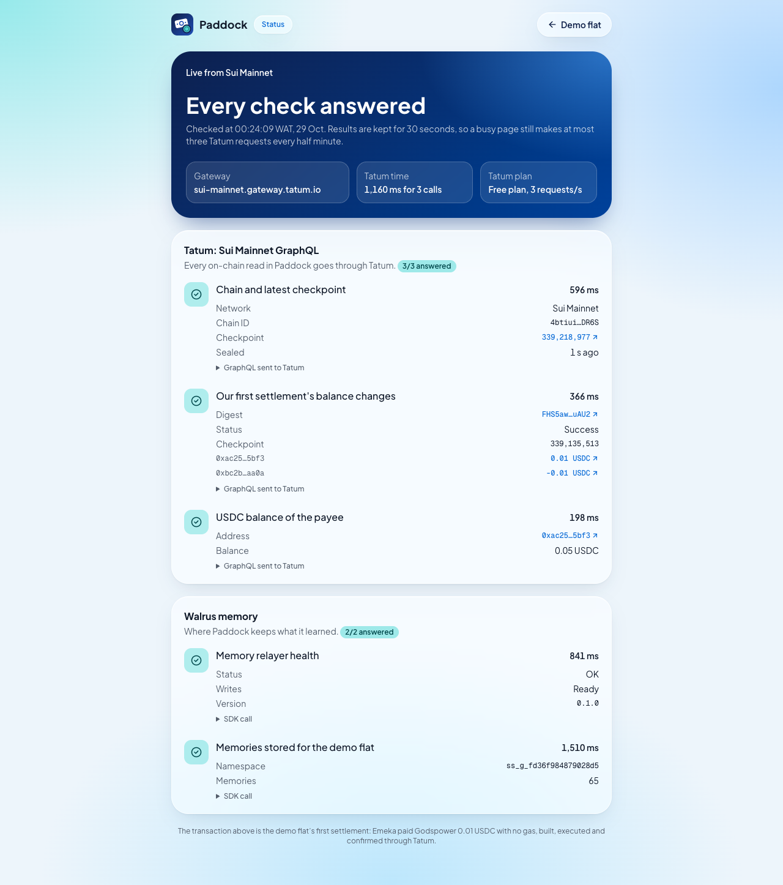

## 3. Walrus Memory on Mainnet

### How many memories, and where

| Namespace | What it holds | Memories |
|---|---|---|
| `ss_g_fd36f984879028d5` | Flat 3B: group profile, 4 ledger checkpoints, what it learned at 5 points in time, 2 payment receipts | **65** |
| `ss_g_37a6c1efd43850de` | The first write-then-read round trip | 2 |
| `ss_g_890a18bd94e3e136` | A group created in the app: the receipt of payment #3 | 1 |
| `ss_app` | The very first Mainnet memory, `kbZuVQp7YD3RJ_SZb-OWw6WwQmPXwWdQQb8M9PsJA0w` | 1 |
| **Total** | | **69** (the hackathon requires at least 10) |

Namespaces are opaque on purpose: `ss_g_` plus the first 16 hex characters of `sha256(groupId + salt)`, so no group or person name is visible in public metadata.

### What a memory looks like

Each memory is a `SPLITSENSE v1` envelope: a one-line header that recall can match, then canonical JSON with `seq`, `prev` (the hash of the previous memory of the same kind) and `hash = sha256(payload without hash)`. When Paddock reads a memory back, it rejects it if the hash, header or namespace doesn't match.

```text
SPLITSENSE v1 | kind=settlement_receipt | group=ss_g_fd36f984879028d5 | subject=FHS5aw5nn9X4… | seq=1 | at=2026-10-28T17:56:20.066Z
{"at":"…","data":{"amountMinor":"1500","checkpoint":"339135513","confirmedBy":"tatum-graphql","digest":"FHS5aw5nn9X4…",
 "from":"emeka","microUsdc":"10000",…},"hash":"0bc14ede…","kind":"settlement_receipt","prev":null,"seq":1,…}
```

### Each memory is a Walrus blob on Sui

The relayer encrypts each memory with SEAL and stores it as a Walrus blob, certified on Sui (`seal_encrypt_fence`, `certify_blob`). The blobs checked on Walruscan run from storage **epoch 42 to epoch 57**. At two weeks per Mainnet epoch, that's about 30 weeks from now, well past judging (Nov 11–17).

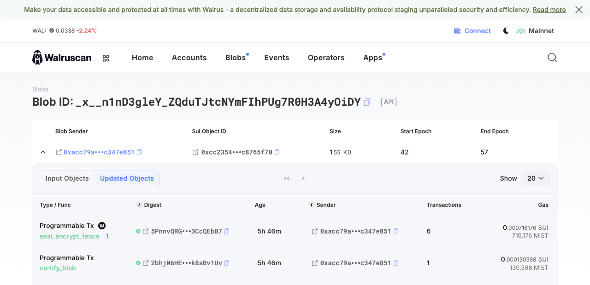

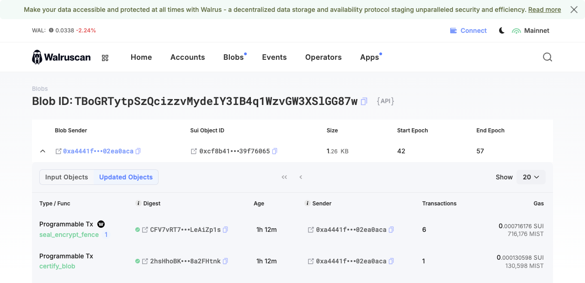

### Read back, verified

The demo doesn't trust its cache: `pnpm memory:refresh` (and the daily cron) recalls the flat from Walrus, re-checks every envelope, and rebuilds the ledger from the 4 checkpoints, hash for hash.

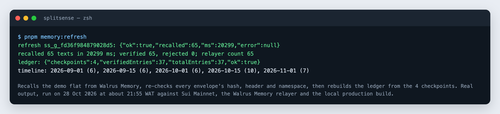

### Every memory written

Generated from the outbox (`memory_outbox`, status `stored`). `#` is the position on the chain for that namespace and kind. The reader keeps the newest "as of" for each subject. It collapses the 21 re-sent copies, which came from a seed run that resumed after a DNS outage (see [`JUDGE-GATES.md`](JUDGE-GATES.md), Brick 2). The one in `turn.groceries` marked "No longer holds" is the app **forgetting** a pattern, recorded as a memory too.

#### `ss_g_37a6c1efd43850de`

| # | Kind | Subject | Learned as of | What it says | Walrus blob |
|---|---|---|---|---|---|
| 1 | group_profile | `group` | – | 4 members, ₦1500 per USDC | [`RzEvZDZgMP…`](https://walruscan.com/mainnet/blob/RzEvZDZgMP8HlIigGXlwrLPRxN83zB_2wVYzwoXsjtw) |
| 1 | pattern_snapshot | `turn.fuel` | 2026-11-01 | Tolu has covered diesel 9 of 12 times. Next diesel: Godspower? | [`vx1FlJDSj7…`](https://walruscan.com/mainnet/blob/vx1FlJDSj76flwajl7SZX9Mje8rZnLxe-43If7yI2NU) |

#### `ss_g_fd36f984879028d5`

| # | Kind | Subject | Learned as of | What it says | Walrus blob |
|---|---|---|---|---|---|
| 1 | group_profile | `group` | – | 4 members, ₦1500 per USDC | [`2lcNCvteAE…`](https://walruscan.com/mainnet/blob/2lcNCvteAEI8s_9bEA6VqR9ljCd5lcXsH2mbGnIXs80) |
| 1 | ledger_checkpoint | `ledger.000` | – | 10 ledger entries, cumulative hash c2191a46… | [`gADJp6sWYh…`](https://walruscan.com/mainnet/blob/gADJp6sWYhcska-GMItBrUqdZNU9yqFFBYXjDFmEPxs) |
| 1 | pattern_snapshot | `turn.fuel` | 2026-09-01 | Tolu has covered diesel 5 of 5 times. Next diesel: Ada? | [`I8ZwMqGQ_L…`](https://walruscan.com/mainnet/blob/I8ZwMqGQ_LmbycPgGRqHYla1hE2iSj3zMqV_2eZGEWM) |
| 2 | pattern_snapshot | `bill.fuel` | 2026-09-01 | Generator diesel comes weekly, next around 2026-09-06, usually ₦25,000 | [`oBGRyzgOOf…`](https://walruscan.com/mainnet/blob/oBGRyzgOOfJ8TV5MBifTdigu8SHrlxnKkkIyjFxf1kw) |
| 1 | member_habit | `godspower` | 2026-09-01 | Godspower usually settles in about 0 days (fast) | [`KT8Gb8STfM…`](https://walruscan.com/mainnet/blob/KT8Gb8STfM6-4h05wvIJ0GOfXB12u5Cs9U8LC5AoVzc) |
| 2 | member_habit | `tolu` | 2026-09-01 | Tolu usually settles in about 3 days (steady) | [`UroVzrBr_8…`](https://walruscan.com/mainnet/blob/UroVzrBr_8WMcSaDN_vi2PtjRgH1KJlapoZ-lB4JivU) |
| 3 | member_habit | `ada` | 2026-09-01 | Ada usually settles in about 5 days (steady) | [`4lgWmi2j8t…`](https://walruscan.com/mainnet/blob/4lgWmi2j8t2xu4NbuGN-dCNpdYFMarhdmGiFFE6v2z8) |
| 4 | member_habit | `emeka` | 2026-09-01 | Emeka usually settles in about 10 days (slow) | [`YpbqPO9d6f…`](https://walruscan.com/mainnet/blob/YpbqPO9d6fQJipTQQ7OYQ5t7pwWrF0YtYFb2rUI25t0) |
| 3 | pattern_snapshot | `turn.fuel` | 2026-09-15 | Tolu has covered diesel 6 of 7 times. Next diesel: Emeka? | [`sofWTiGmwq…`](https://walruscan.com/mainnet/blob/sofWTiGmwq_Yv7IdeXwGuuoaTiJUPW2bLFs6g8l8KJ0) |
| 4 | pattern_snapshot | `bill.fuel` | 2026-09-15 | Generator diesel comes weekly, next around 2026-09-20, usually ₦25,000 | [`mkctZq1Mm0…`](https://walruscan.com/mainnet/blob/mkctZq1Mm0FlWPryUUIpXE9JftxfcXUA2LikmLu9er0) |
| 5 | member_habit | `godspower` | 2026-09-15 | Godspower usually settles in about 1 days (fast) | [`mPii5kvXOR…`](https://walruscan.com/mainnet/blob/mPii5kvXORMGb22Sdiv6IziPSWlxZt3Ost4sdzlOiIc) |
| 6 | member_habit | `tolu` | 2026-09-15 | Tolu usually settles in about 4 days (steady) | [`4ZYdQujyia…`](https://walruscan.com/mainnet/blob/4ZYdQujyiaAnSH0LDTDW8oXurmV4j-iDK-eAQZSDros) |
| 7 | member_habit | `ada` | 2026-09-15 | Ada usually settles in about 5 days (steady) | [`I1WBn9nJSf…`](https://walruscan.com/mainnet/blob/I1WBn9nJSfjJ8lmKODSIwbDfZwI-kz4I-JlfZwpaMNw) |
| 8 | member_habit | `emeka` | 2026-09-15 | Emeka usually settles in about 10 days (slow) | [`e_Bdb8i8p8…`](https://walruscan.com/mainnet/blob/e_Bdb8i8p8rIPw8-_1fUTA6RHOUFqFQ79WqlfKnXQ4E) |
| 2 | ledger_checkpoint | `ledger.001` | – | 20 ledger entries, cumulative hash 8ca47861… | [`jIrqcupZGx…`](https://walruscan.com/mainnet/blob/jIrqcupZGxsCk4a91JPI6zZvMKt1OfbgK-cfrIgl60Q) |
| 5 | pattern_snapshot | `turn.fuel` | 2026-10-01 | Tolu has covered diesel 8 of 9 times. Next diesel: Emeka? | [`t2XFkAIVsO…`](https://walruscan.com/mainnet/blob/t2XFkAIVsOV8KAvEr5NXe2Pfmcx8RDgiXB_XenBsuLI) |
| 6 | pattern_snapshot | `bill.fuel` | 2026-10-01 | Generator diesel comes weekly, next around 2026-10-04, usually ₦25,000 | [`s890ajXSa4…`](https://walruscan.com/mainnet/blob/s890ajXSa4aI9upRdoOPKbYpxq5X8_CXrueVc2g8LUo) |
| 7 | pattern_snapshot | `bill.power` | 2026-10-01 | IKEDC prepaid token comes biweekly, next around 2026-10-14, usually ₦40,000 | [`tHRTz6W1Bh…`](https://walruscan.com/mainnet/blob/tHRTz6W1BhaH4aFFeUDBIWtOyCIeZDzb67sTtrFZw5Y) |
| 9 | member_habit | `godspower` | 2026-10-01 | Godspower usually settles in about 1 days (fast) | [`QA1t6I9edO…`](https://walruscan.com/mainnet/blob/QA1t6I9edO7FCkv3sfzCCONDG7uEiVEBnkqPzKOWvp0) |
| 10 | member_habit | `tolu` | 2026-10-01 | Tolu usually settles in about 4 days (steady) | [`be09k0TKHl…`](https://walruscan.com/mainnet/blob/be09k0TKHlrETuRLezF_M-V81JTgpKTl2szFgmKJk2I) |
| 11 | member_habit | `ada` | 2026-10-01 | Ada usually settles in about 5 days (steady) | [`uPr6cK1PUN…`](https://walruscan.com/mainnet/blob/uPr6cK1PUNErXFqFpq0_4oE-ABHYevSh6euY1TU7aJM) |
| 12 | member_habit | `emeka` | 2026-10-01 | Emeka usually settles in about 10 days (slow) | [`q1WkK0FzvE…`](https://walruscan.com/mainnet/blob/q1WkK0FzvEHg9SdIVCjyzcKS6UPGZ4F7nvYNuvXilGQ) |
| 3 | ledger_checkpoint | `ledger.002` | – | 30 ledger entries, cumulative hash 34dd87c4… | [`BAY2pSYKW6…`](https://walruscan.com/mainnet/blob/BAY2pSYKW6FxqeWaawSBkKs-QWDeGbgZ_ZBOLOKL44Q) |
| 8 | pattern_snapshot | `turn.fuel` | 2026-10-15 | Tolu has covered diesel 8 of 11 times. Next diesel: Godspower? | [`qJdYZfI0Ay…`](https://walruscan.com/mainnet/blob/qJdYZfI0Ayd1Bzxzbb9B1HXU7eREG6AwXPlYRv8AA1Y) |
| 9 | pattern_snapshot | `turn.groceries` | 2026-10-15 | Godspower has covered groceries 3 of 6 times. Next groceries: Emeka? | [`76YbmoXGco…`](https://walruscan.com/mainnet/blob/76YbmoXGco155eQS8uPcA81ZDiNQ0zlQ8NC2GY9sRBg) |
| 10 | pattern_snapshot | `bill.fuel` | 2026-10-15 | Generator diesel comes weekly, next around 2026-10-18, usually ₦25,000 | [`SWoCmURrfp…`](https://walruscan.com/mainnet/blob/SWoCmURrfpRIJ1LecC1iL0GSlQJZu_TeSDbWZLoqae0) |
| 11 | pattern_snapshot | `bill.power` | 2026-10-15 | IKEDC prepaid token comes biweekly, next around 2026-10-28, usually ₦40,000 | [`YSSSPtHuX1…`](https://walruscan.com/mainnet/blob/YSSSPtHuX1CL3B2rkCOVu6LqDwKqfd3et5LNuGBRBlc) |
| 12 | pattern_snapshot | `bill.utilities` | 2026-10-15 | LAWMA waste comes monthly, next around 2026-11-01, usually ₦5,000 | [`TaNCJL0swu…`](https://walruscan.com/mainnet/blob/TaNCJL0swuBfkHVKjzsga8JtKV1b11fTbf47Mi0cjPg) |
| 13 | pattern_snapshot | `bill.data` | 2026-10-15 | Spectranet data comes monthly, next around 2026-11-06, usually ₦30,000 | [`04MHcnCnZH…`](https://walruscan.com/mainnet/blob/04MHcnCnZHKBoDDD2ExT3IaP2dTwvGk0-4hPyhgJW_8) |
| 13 | member_habit | `godspower` | 2026-10-15 | Godspower usually settles in about 1 days (fast) | [`JAEQ77tus_…`](https://walruscan.com/mainnet/blob/JAEQ77tus_0fa9gIxUFO0Jm6byPeXnHpcefYeYne2_w) |
| 14 | member_habit | `tolu` | 2026-10-15 | Tolu usually settles in about 4 days (steady) | [`8aBGf9Kaby…`](https://walruscan.com/mainnet/blob/8aBGf9Kaby0q07UI_xmL65Iy_xFH1T7z7G3piYg9f3c) |
| 15 | member_habit | `ada` | 2026-10-15 | Ada usually settles in about 5 days (steady) | [`UDlKpgzuQz…`](https://walruscan.com/mainnet/blob/UDlKpgzuQzjXfdGOMYuDO_SQliQ418Al8Kf6Tq8jlZs) |
| 16 | member_habit | `emeka` | 2026-10-15 | Emeka usually settles in about 9 days (slow) | [`cBhglS7f_v…`](https://walruscan.com/mainnet/blob/cBhglS7f_v4p5qKEJmD9nbYrjHAFU3bKEJo4Clpz-L0) |
| 4 | ledger_checkpoint | `ledger.003` | – | 37 ledger entries, cumulative hash e7334572… | [`wwrlKHpvtS…`](https://walruscan.com/mainnet/blob/wwrlKHpvtSdd5ny5DcvhWLJvILhZC5wnxUosp6RCfaQ) |
| 14 | pattern_snapshot | `turn.fuel` | 2026-11-01 | Tolu has covered diesel 9 of 12 times. Next diesel: Godspower? | [`_x__n1nD3g…`](https://walruscan.com/mainnet/blob/_x__n1nD3gleY_ZQduTJtcNYmFIhPUg7R0H3A4yOiDY) |
| 15 | pattern_snapshot | `bill.fuel` | 2026-11-01 | Generator diesel comes weekly, next around 2026-11-01, usually ₦25,000 | [`hSlx27EbqV…`](https://walruscan.com/mainnet/blob/hSlx27EbqVbSaB9-mnQoOjzwiXN3XTDKe70aQ7rvmow) |
| 16 | pattern_snapshot | `bill.power` | 2026-11-01 | IKEDC prepaid token comes biweekly, next around 2026-11-11, usually ₦40,000 | [`MtbhzUdHuq…`](https://walruscan.com/mainnet/blob/MtbhzUdHuqmkjpTImuHF_gMGD2h0t5T0Mkh72Yinqy4) |
| 17 | member_habit | `godspower` | 2026-11-01 | Godspower usually settles in about 1 days (fast) | [`LKOt2hETQx…`](https://walruscan.com/mainnet/blob/LKOt2hETQx2GRK1Vibp_Ds5caVk6zmuZ8MbCEB7Ueh4) |
| 18 | member_habit | `tolu` | 2026-11-01 | Tolu usually settles in about 4 days (steady) | [`xa2nSUp094…`](https://walruscan.com/mainnet/blob/xa2nSUp094hiOhRb4Ig49c30oa_Mcm0ctKXL7e1xqH0) |
| 19 | member_habit | `ada` | 2026-11-01 | Ada usually settles in about 5 days (steady) | [`qFTS09jpNe…`](https://walruscan.com/mainnet/blob/qFTS09jpNezRRqUpfU88qDaO2y-aZXI2BNugRT6v71I) |
| 20 | member_habit | `emeka` | 2026-11-01 | Emeka usually settles in about 9 days (slow) | [`bgEM3WeGDn…`](https://walruscan.com/mainnet/blob/bgEM3WeGDn7u-kdv7B33-bf6IonAqxt3F74_5KWGQy0) |
| 17 | pattern_snapshot | `turn.fuel` | 2026-09-01 | Tolu has covered diesel 5 of 5 times. Next diesel: Ada? *(re-sent copy of #1; the reader collapses it)* | [`0UDJ7EViPs…`](https://walruscan.com/mainnet/blob/0UDJ7EViPsph499yZenlxwmmtmguVnJgTDoa99sUES0) |
| 18 | pattern_snapshot | `bill.fuel` | 2026-09-01 | Generator diesel comes weekly, next around 2026-09-06, usually ₦25,000 *(re-sent copy of #2; the reader collapses it)* | [`7vVe3LLLvV…`](https://walruscan.com/mainnet/blob/7vVe3LLLvVbJb7_PuXUYNydgCB0VGecY5DykvJvZkzM) |
| 21 | member_habit | `godspower` | 2026-09-01 | Godspower usually settles in about 0 days (fast) *(re-sent copy of #1; the reader collapses it)* | [`ZiiI08Pn3n…`](https://walruscan.com/mainnet/blob/ZiiI08Pn3n-s42fSIg07XXIb9P0MbVv3ZAE5gQY-Mpk) |
| 22 | member_habit | `tolu` | 2026-09-01 | Tolu usually settles in about 3 days (steady) *(re-sent copy of #2; the reader collapses it)* | [`uus3q84dwq…`](https://walruscan.com/mainnet/blob/uus3q84dwq9QwPX6bSEzKvj-ZwtwrI2gBAFFUskNEbk) |
| 23 | member_habit | `ada` | 2026-09-01 | Ada usually settles in about 5 days (steady) *(re-sent copy of #3; the reader collapses it)* | [`gu-U_jH512…`](https://walruscan.com/mainnet/blob/gu-U_jH512_x0cVPb8eJAFQB8dgpgzVvKYWcmaeoYZw) |
| 24 | member_habit | `emeka` | 2026-09-01 | Emeka usually settles in about 10 days (slow) *(re-sent copy of #4; the reader collapses it)* | [`dF6geXx-KE…`](https://walruscan.com/mainnet/blob/dF6geXx-KExhSiM-fLJphbTzh7vCN-PbyCjIAodyvl4) |
| 19 | pattern_snapshot | `turn.fuel` | 2026-09-15 | Tolu has covered diesel 6 of 7 times. Next diesel: Emeka? *(re-sent copy of #3; the reader collapses it)* | [`xxFrO8TfKc…`](https://walruscan.com/mainnet/blob/xxFrO8TfKc3kMdjscp3ncrLUdO-yYK6leEN-GqzIKBM) |
| 20 | pattern_snapshot | `bill.fuel` | 2026-09-15 | Generator diesel comes weekly, next around 2026-09-20, usually ₦25,000 *(re-sent copy of #4; the reader collapses it)* | [`1GqjEY5HFV…`](https://walruscan.com/mainnet/blob/1GqjEY5HFVe6d5l_jWDmOAoMhLmYcH2fIfE5-hgmlxU) |
| 25 | member_habit | `godspower` | 2026-09-15 | Godspower usually settles in about 1 days (fast) *(re-sent copy of #5; the reader collapses it)* | [`fmUsPyJegl…`](https://walruscan.com/mainnet/blob/fmUsPyJeglG8hB5ZUh3zLcY8PBL6NeYh5E6FWr-tHKI) |
| 26 | member_habit | `tolu` | 2026-09-15 | Tolu usually settles in about 4 days (steady) *(re-sent copy of #6; the reader collapses it)* | [`eeBaRfpFDz…`](https://walruscan.com/mainnet/blob/eeBaRfpFDzET-kyEFD5-eZ-ua1uLyxhJ1FxradEIhIE) |
| 27 | member_habit | `ada` | 2026-09-15 | Ada usually settles in about 5 days (steady) *(re-sent copy of #7; the reader collapses it)* | [`bkgXqc2wFe…`](https://walruscan.com/mainnet/blob/bkgXqc2wFeikvW8zAn8fQZOUdZ0mMTtSD74soWwsvks) |
| 28 | member_habit | `emeka` | 2026-09-15 | Emeka usually settles in about 10 days (slow) *(re-sent copy of #8; the reader collapses it)* | [`f2j1oecRBz…`](https://walruscan.com/mainnet/blob/f2j1oecRBzls1r8nF1BdLG0472U7xfeWmw75_sbyyoA) |
| 21 | pattern_snapshot | `turn.fuel` | 2026-10-01 | Tolu has covered diesel 8 of 9 times. Next diesel: Emeka? *(re-sent copy of #5; the reader collapses it)* | [`4L_Ay19OVI…`](https://walruscan.com/mainnet/blob/4L_Ay19OVIpmiHtKXxxbeMB-WE0DO__8mi9rdJ2QBP0) |
| 22 | pattern_snapshot | `bill.fuel` | 2026-10-01 | Generator diesel comes weekly, next around 2026-10-04, usually ₦25,000 *(re-sent copy of #6; the reader collapses it)* | [`72I6GOyCet…`](https://walruscan.com/mainnet/blob/72I6GOyCetHwxvdDEl2q3rN6g2oQVabZ6YRUF-v4MKI) |
| 23 | pattern_snapshot | `bill.power` | 2026-10-01 | IKEDC prepaid token comes biweekly, next around 2026-10-14, usually ₦40,000 *(re-sent copy of #7; the reader collapses it)* | [`kuFcLm2NS9…`](https://walruscan.com/mainnet/blob/kuFcLm2NS94ZVTEn_dYS1Rqk68bsXfKurO1GSmjeqaU) |
| 29 | member_habit | `godspower` | 2026-10-01 | Godspower usually settles in about 1 days (fast) *(re-sent copy of #9; the reader collapses it)* | [`s7QmQBzuaf…`](https://walruscan.com/mainnet/blob/s7QmQBzuafcGS6L6LBtqBGmqOQwcW3tBGdxsGH3DyUc) |
| 30 | member_habit | `tolu` | 2026-10-01 | Tolu usually settles in about 4 days (steady) *(re-sent copy of #10; the reader collapses it)* | [`gXohzGfs6S…`](https://walruscan.com/mainnet/blob/gXohzGfs6SMpPiboriwpOuojLycbZEw6DbVSKNMtltk) |
| 31 | member_habit | `ada` | 2026-10-01 | Ada usually settles in about 5 days (steady) *(re-sent copy of #11; the reader collapses it)* | [`Jh2PmY2Gq2…`](https://walruscan.com/mainnet/blob/Jh2PmY2Gq2tlUVwIouUomdVyUlY3vAXJ8Ljp-klBl7g) |
| 32 | member_habit | `emeka` | 2026-10-01 | Emeka usually settles in about 10 days (slow) *(re-sent copy of #12; the reader collapses it)* | [`411gPo7mGE…`](https://walruscan.com/mainnet/blob/411gPo7mGEXTeY4oDEFQH4THGY5pBnzIJPp0gUNC5R4) |
| 24 | pattern_snapshot | `turn.fuel` | 2026-10-15 | Tolu has covered diesel 8 of 11 times. Next diesel: Godspower? *(re-sent copy of #8; the reader collapses it)* | [`HvkXvOUZx0…`](https://walruscan.com/mainnet/blob/HvkXvOUZx0m16FWqANrT-hxdm2_Ksp1nKo8ZkZyOGrY) |
| 25 | pattern_snapshot | `bill.fuel` | 2026-10-15 | Generator diesel comes weekly, next around 2026-10-18, usually ₦25,000 *(re-sent copy of #10; the reader collapses it)* | [`aUIJq1FfaL…`](https://walruscan.com/mainnet/blob/aUIJq1FfaLdyz5Gwuqh3gfw2JwsT1Vs-OIpk3n4DOVQ) |
| 26 | pattern_snapshot | `turn.groceries` | 2026-11-01 | No longer holds as of 2026-11-01: Godspower has covered groceries 3 of 6 times. Next groceries: Emeka? | [`3W2ixPFsMA…`](https://walruscan.com/mainnet/blob/3W2ixPFsMA61sgiCnez8fvTHWhFfyrE_FGElFhiAtqc) |
| 1 | settlement_receipt | [`FHS5aw5n…`](https://suiscan.xyz/mainnet/tx/FHS5aw5nn9X4DKRevpoTKs4yMGhUnHEsgT725THiuAU2) | – | 0.01 USDC emeka → godspower, confirmed by tatum-graphql | [`2mnwqBb4M-…`](https://walruscan.com/mainnet/blob/2mnwqBb4M-kSmnUU8qhrV9mqi7cRLaO_-fmfxsapY0U) |
| 2 | settlement_receipt | [`Eu7yRGab…`](https://suiscan.xyz/mainnet/tx/Eu7yRGabs6aHsM7pERoULg3HnfM9zZuYRnUNmaNSiXwc) | – | 0.01 USDC godspower → tolu, confirmed by tatum-graphql | [`AhdHmgZ9mq…`](https://walruscan.com/mainnet/blob/AhdHmgZ9mqssiPHcqBoiSgfZNIfP7XmSmHokRU8lJoI) |

#### `ss_g_890a18bd94e3e136`

| # | Kind | Subject | Learned as of | What it says | Walrus blob |
|---|---|---|---|---|---|
| 1 | settlement_receipt | [`9V57Dbu9…`](https://suiscan.xyz/mainnet/tx/9V57Dbu95yuikVhYysxreSg7vFL3PxFqzNJMgQkV5QUV) | – | 0.05 USDC member 578ea258 → member f4cf5df7, confirmed by tatum-graphql | [`TBoGRTytpS…`](https://walruscan.com/mainnet/blob/TBoGRTytpSzQcizzvMydeIY3IB4q1WzvGW3XSlGG87w) |

## 4. Tests and app checks

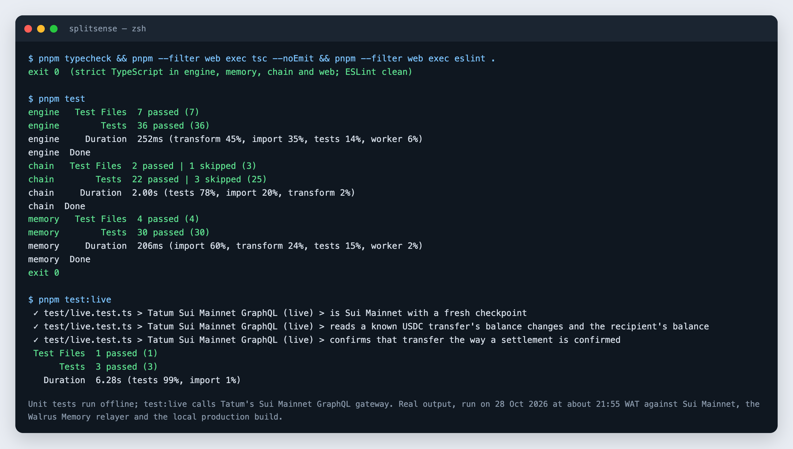

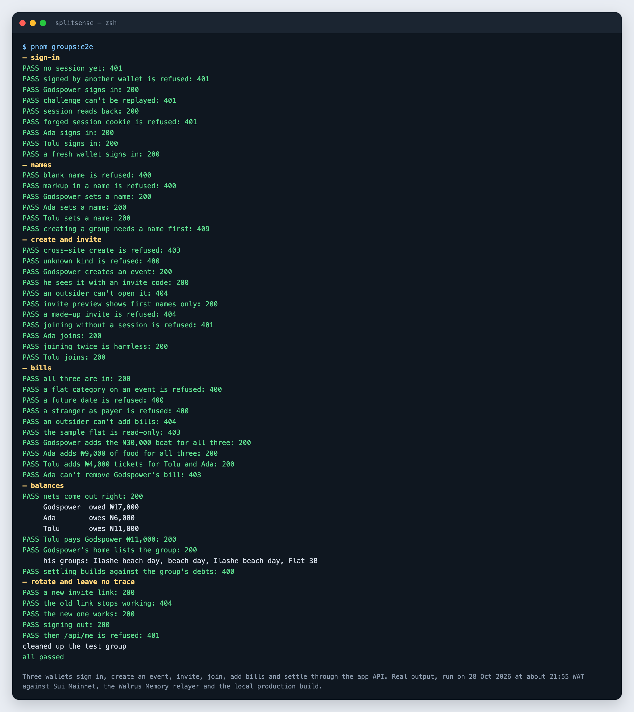

Every unit test by name: [`screens/proof/proof-unit-tests.png`](screens/proof/proof-unit-tests.png).

## 5. Raw evidence

| File | What it records |
|---|---|
| [`evidence/brick1-roundtrip.json`](evidence/brick1-roundtrip.json) | First write → Walrus → recall → hash match |
| [`evidence/brick2-seed.json`](evidence/brick2-seed.json) | The Flat 3B seed: every memory, envelope hash and blob ID |
| [`evidence/brick4-status.json`](evidence/brick4-status.json) | The `/status` Tatum calls, queries and latencies |
| [`JUDGE-GATES.md`](JUDGE-GATES.md) | Each production step, what it had to prove, and the evidence |
