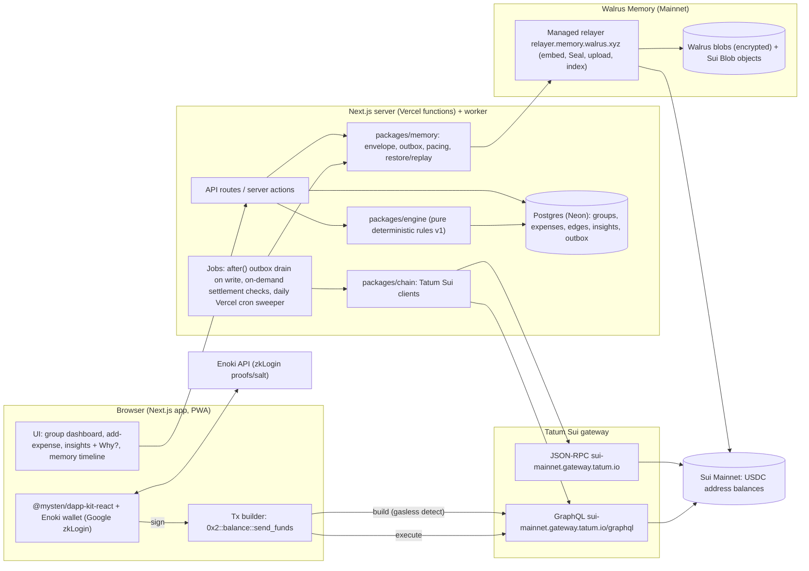

# SplitSense: Design and Build Plan

**Author:** Godspower Ufot (Lagos, WAT = UTC+1)
**Event:** Tatum x Walrus "Total Recall" hackathon, Consumer Finance Apps track (also going for Best Walrus Memory)
**Window:** Tue Oct 20 to Tue Nov 10, 2026. Submissions close **Nov 10, 17:00 UTC (18:00 WAT)**. Results Nov 17.
**Doc date:** Mon Oct 19, 2026

> Any claim about an external API is tagged with its source in §10. If something wasn't documented or verified, it's marked **[OPEN]** and listed in §9.

> **Changelog: Oct 19, 2026 (after judging calibration, see JUDGING_CALIBRATION.md)**
> - Resolved 3 form-field OPENs using the official form's help text (§3.1, §6, §9).
> - Added **R0 quick-entry parser** and **R11 outcome learning** (§2.3), and the **memory-first learned layer** (§3.6).
> - Replaced minute-level Vercel Cron, which **won't deploy on the Hobby plan**, with `after()` drains, on-demand settlement checks, and a daily sweeper (§4, §5, new R-14).
> - Added **MVP / Stretch tiers** (§6.0), **judge mode `/demo`**, a **"Verify it yourself"** README, and a **`/status`** Tatum page (§6.3).
> - Fixed social tagging: on X tag **@tatum_io + @WalrusProtocol**. @WalrusFoundation isn't a valid X handle; "Walrus Foundation" is the LinkedIn page (§6).
> - Rewrote R-9: the AI Builder companion is dropped because the rules allow **one submission per person** (§8).
> - Added registration findings (§6.4). The original version is kept as `DESIGN.orig-2026-10-19.md`.

---

## 1. Pitch

**One-liner (lead with this everywhere):** *the group-money app that remembers how your flat actually lives, and can prove every suggestion.* (Explainable, verifiable memory plus Lagos money realities. Don't lead with "split bills": that's the brief's own example idea.)

SplitSense is a shared-spending app for flatmates, trips and friend groups, and it remembers how your group actually lives. You log "₦25k diesel, Tolu paid" the way you'd text it. SplitSense keeps the running balance. Over the weeks it picks up the group's habits: rent falls due on the 1st, Tolu covers generator fuel, Ada's data bundle renews on the 5th, Emeka settles about 9 days late and pays near month-end. It uses those habits to pre-fill splits, suggest whose turn it is, and time reminders. No AI model is involved. Every suggestion comes from a small, versioned set of rules with fixed thresholds, so the same history always gives the same suggestion, and each one has a "why?" link that shows the numbers. The learned patterns are stored as encrypted Walrus Memory on Mainnet, so a group's history and habits move with it across devices and sessions. Members can rebuild everything from Walrus on a new phone. Debts are settled in USDC on Sui through Google sign-in (zkLogin via Enoki) using Sui's gasless stablecoin transfers. Nobody sees a wallet, seed phrase or gas token, and every on-chain read and transaction goes through Tatum's Sui gateway.

---

## 2. The deterministic pattern engine

### 2.1 Principles
- **Pure function:** `runRules(ledger, learned, now, rulesetVersion) -> Insight[]` (`learned` = prefs, aliases, habits, outcomes recalled from memory, see §3.6). It does no I/O, no `Date.now()` (`now` is an input), and no randomness. It lives in `packages/engine`.
- **Reproducible:** each `Insight` includes `rulesetVersion`, `inputsHash = sha256(canonicalJSON(inputs))`, and the exact numbers used. A golden test pins the outputs for the seeded Lagos dataset.
- **Explainable:** each `Insight` has `explanation: { summary, facts: [{label, value}], formula, threshold, evidenceExpenseIds[] }`, which the UI shows behind "Why?".
- **Deterministic tie-breaks:** always by (score desc, last-activity asc, memberId asc).
- **Money:** integers in minor units (kobo for NGN, micro-USDC for USDC with 6 decimals). Medians use the lower-middle element so the result stays an integer.
- **Embeddings are retrieval only:** the MemWal relayer embeds memory text so it can be recalled. That vector is never used for a decision. We do **not** use `analyze()` or `withMemWal` (both use an LLM for fact extraction). Source: Relayer overview, API reference.

### 2.2 Shared definitions
- Lookback window `W = 90 days` unless noted. `n` = sample count. `median()` = lower median. `CV(x) = stdev(x)/mean(x)`.
- An **expense** is `{id, groupId, ts, amountMinor, currency, payerId, category, description, split: {memberId: weightBps}}`.
- A **debt edge** is created per expense participant (owed = amount × weight), and **closed** by a settlement (USDC on-chain or "marked paid in cash").

### 2.3 Rules (ruleset `v1`)

| # | Rule | Inputs | Output | Formula / threshold |
|---|------|--------|--------|---------------------|
| R0 | **Quick-entry parser** *(new Oct 19)* | one free-text line, group member names, learned aliases | `{amountMinor, currency, description, payerId?, participants?}` or a parse error with the unparsed span highlighted | Deterministic tokenizer plus a fixed grammar, no LLM. Amount: `₦?\d+(\.\d+)?[km]?` (k = ×1,000, m = ×1,000,000, commas allowed). Payer: `<name> paid` / `paid by <name>` / `— me`. Participants: `split <names…>` / `for <names…>`. Names are matched exactly against member display names and learned nicknames (memory `preference.alias` scope=member). Everything left over becomes the description and goes to R1. Examples: "25k diesel tolu paid", "₦4,500 LAWMA — me", "shoprite 38k split ada emeka". |
| R1 | **Category resolver** | description, group alias table (learned), global keyword dictionary | `category`, `matchedBy` | Matching order: (1) exact group alias, (2) longest keyword match in dictionary, (3) `other`. Dictionary examples: `fuel/diesel/petrol/PMS/gen` → fuel; `NEPA/PHCN/token/prepaid/IKEDC/EKEDC` → power; `data/MTN/Airtel/Glo/Spectranet/wifi` → data; `Shoprite/market/foodstuff/groceries` → groceries; `rent/service charge` → housing; `LAWMA/waste` → utilities. When a user corrects a category, that correction becomes a learned alias (memory `preference.alias`). |
| R2 | **Recurrence detector** | expenses of one (category, payee-key) series in the last 180 days | `{cadence, nextExpectedDate, expectedAmount, confidence}` | Requires `n ≥ 3`. `Δ` = days between consecutive entries. Cadence buckets: weekly if `median(Δ) ∈ [5,9]`, biweekly `[12,16]`, monthly `[26,34]` *or* the same day-of-month ±3. Recurring if `CV(Δ) ≤ 0.25` **and** `CV(amount) ≤ 0.20`. `next = last + median(Δ)`, `expected = median(amount)`, `confidence = min(1, n/6) × (1 − CV(Δ)) × (1 − CV(amount))`. Shown if confidence ≥ 0.5. |
| R3 | **Usual payer (category ownership)** | 90-day expenses in category c | `{memberId, share, count}` or none | `share_m = Σpaid_m / Σpaid`. "Usual payer" if `share ≥ 0.60` **and** `count_m ≥ 3` **and** total category entries ≥ 4. Strength: `strong` ≥ 0.80, `moderate` 0.60–0.79. |
| R4 | **Payment-timing window (payday)** | a member's settlement timestamps (≥ 3) | `{centerDay, spreadDays}` or none | Converts day-of-month to an angle and takes the **circular mean** (so the 30th and the 2nd sit next to each other). `spread` = circular median absolute deviation in days. A window exists if `spread ≤ 3`. Example: "Emeka usually pays around the 27th (±2 days)." |
| R5 | **Settlement speed / reliability** | per member, `delay = settledAt − expenseTs` (days) for closed edges in 120 days | `{medianDelay, p80Delay, ewmaDelay, score}` | `ewma_t = 0.3·delay_t + 0.7·ewma_{t−1}` in settlement order. `score = clamp(100 − 8·ewmaDelay, 0, 100)`, rounded. Labels: ≥ 80 "fast", 50–79 "steady", < 50 "slow". This rule visibly changes over time. |
| R6 | **Fair-split suggestion** | new expense's category c, last k=3 splits in c, R3 output, per-member category contribution | `suggestedSplit`, optional `suggestedNextPayer` | (a) **Template:** if the last 3 splits in c are identical, pre-fill that split ("last 3 grocery runs were 40/30/30"). Otherwise use an equal split over the members who took part in c over the 90 days. (b) **Rotation:** for each member, `gap_m = fairShare_c − paid_m,c`. Suggested next payer = `argmax gap_m`, ties broken by longest time since they last paid in c, then by memberId. Shown only when R3 has found a usual payer and the top `gap ≥ 15%` of the category's 90-day spend. Example: "Tolu has covered fuel 5 of 6 times (₦127k of ₦152k). Next fuel: Ada?" |
| R7 | **Net balances & minimal transfers** | all open edges | per-member net, transfer list | `net_m = paid − owed`. Greedy: debtors sorted by owed desc and creditors by credit desc (ties by memberId). Pair them repeatedly and transfer `min(owe, credit)`. This produces at most `members − 1` transfers and is deterministic. Each transfer lists the expense IDs it nets out. |
| R8 | **Anomaly & missed-recurring** | R2 series | flag | **Spike:** a new amount `> 1.5 × expectedAmount` (or `< 0.5×`). **Missed:** `now > nextExpected + tolerance` (weekly 3d, biweekly 4d, monthly 5d) with no matching entry. Example: "Data bundle (₦30k, usually ~5th) isn't logged for November yet." |
| R9 | **Nudge scheduler** | open debts, R4, R5 | `nudgeAt` per debtor | If the debtor has an R4 window: `nudgeAt = next windowStart (center − spread)`. Otherwise `nudgeAt = debtCreated + max(2, round(medianDelay/2))` days. Escalation: second nudge +3 days, then weekly. At most 1 nudge per debtor per 48 hours. |
| R11 | **Outcome learning** *(new Oct 19)* | per debtor: nudges sent `(nudgeAt, weekday, dayOfMonth)` and whether a settlement followed within 48h; per accepted R6 rotation: whether the suggested payer actually paid the next entry in c | `nudgeHitRate` per day-of-month bucket, `rotationFollowRate`, adjusted R9 `nudgeAt`, adjusted R6 display threshold | Needs `n ≥ 3` nudges. `hit = settled within 48h of a nudge`. When a debtor has an R4 window and `hitRate(window) < 0.34` after ≥ 3 nudges, R9 moves to the bucket with the highest hit rate (ties: earliest day, then the R4 center). `rotationFollowRate < 0.34` over ≥ 3 accepted rotations raises the R6 gap bar from 15% to 25%. Every adjustment writes an `outcome` memory, and the timeline shows the diff ("Emeka's nudge moved from the 25th to the 28th: 0 of 3 nudges on the 25th worked"). |
| R10 | **Feedback dampener (preferences)** | per (group, ruleId, subjectKey): `shown`, `accepted`, `dismissed` | `suppressed`, `confidenceMultiplier` | `acceptRate = accepted/shown`. Suppressed if `shown ≥ 4` and `acceptRate < 0.30`, and the explanation says so ("hidden: you dismissed this 3 of 4 times"). It comes back if the underlying stats change by more than 20%, or the user selects "show again". |

### 2.4 Worked example (seeded flat, see §7)
Fuel entries: Aug 2, 9, 16, 23, 30, Sep 6. Tolu paid five of them, Ada paid Sep 6. Amounts were ₦25k, 24k, 26k, 25k, 27k, 25k.
- **R2:** Δ = [7,7,7,7,7], median 7 → weekly. CV(Δ)=0. CV(amount) ≈ 0.04. `confidence = min(1, 6/6) × 1 × 0.96 = 0.96`. Next expected Sep 13, ₦25k.
- **R3:** Tolu paid ₦127k of ₦152k, share 0.836 ≥ 0.80 → "strong". Text: "Tolu usually covers fuel (5 of 6, 84%)."
- **R6:** fair share per head (4 members) = ₦38k. Gaps are Ada +13k, Godspower +38k, Emeka +38k, Tolu −89k. Godspower and Emeka tie on 38k. The tie-break goes to the one who paid fuel longest ago: neither has ever paid, so it falls to memberId ("emeka" < "godspower"). Suggestion: "Next fuel: Emeka?" The top gap of ₦38k is 25% of ₦152k, which clears the 15% bar.
- **R7:** with nets G +₦40k, T +₦25k, A −₦15k, E −₦50k: E→G ₦40k, E→T ₦10k, A→T ₦15k (3 transfers).
- **R5:** Emeka's delays were 6, 9, 11, 8 days. EWMA starting at 6: 6.9, 8.13, 8.09. `score = 100 − 8·8.09 = 35` → "slow". Godspower (delays 1, 0, 2) scores 91 → "fast".

---

## 3. Memory schema and the learning loop

### 3.1 What Walrus Memory gives us (documented)
- A **memory** is a piece of **text** stored with `remember(text, namespace?)`. The relayer embeds it, Seal-encrypts it, uploads it to Walrus as a blob, and indexes the vector. The call returns `{job_id, status}`. `rememberAndWait` returns `{id, job_id, blob_id, owner, namespace}`. `rememberBulk(items)` accepts up to 20 items at once. Recall is semantic, `recall({query, limit, namespace, sort:"recent"})`, and returns decrypted `text` plus `blob_id`, `distance` and `created_at`. `listMemories()` returns metadata only (including `agent_id`, `end_epoch`, `expires_at`). `restore(namespace)` rebuilds the relayer index from Walrus. [MemWal API ref]
- Authentication uses an Ed25519 **delegate key** registered on an on-chain `MemWalAccount`. Credentials are generated once at memory.walrus.xyz (Mainnet). The Mainnet relayer is `https://relayer.memory.walrus.xyz`. Package: `@mysten-incubation/memwal` (v0.1.8 on npm as of Oct 16, 2026). [Quick start, Headless setup]
- On the **managed relayer the server wallet pays WAL and SUI**, so we hold no WAL. Limits: 60 points/min and 500 points/hour per account, 30 points/min per delegate key, 1 GB storage. `remember` costs 5 points and `recall` costs 1. **That allows about 6 `remember` calls per minute per key and about 100 per hour per account.** [Relayer overview, Managed relayer]
- Expiry: a memory lasts for the epochs that were paid for. Mainnet epochs are about 2 weeks. The relayer sidecar's default on Mainnet is 2–3 epochs; the two doc pages disagree. Lapsed blobs can't be recovered. [Manage your memory, Env vars, Self-hosting]
- Privacy: content is encrypted, but `memwal_namespace`, `memwal_owner` and `memwal_agent_id` are **public plaintext** in on-chain blob metadata. **So namespaces are opaque hashes, never names.** [MemWal GH issue #315]
- `memwal_agent_id` in on-chain metadata is the **delegate key's public key** [issue #315], and `listMemories` exposes `agent_id`. **Confirmed Oct 19 from the official form:** "MEMWAL_AGENT_ID is the Public key under Delegate keys on memory.walrus.xyz/dashboard". It should equal `memwal.getPublicKeyHex()`, so assert that in `scripts/memory-health.ts`. The form's "Account ID (SUI)" is "the ID you receive after you created your first delegate key" on the same dashboard (= `MEMWAL_ACCOUNT_ID`).

### 3.2 Namespacing
- One app-level `MemWalAccount`, with its delegate key held server-side only.
- Namespace per group: `ss_g_<first 16 hex of sha256(groupId + NAMESPACE_SALT)>`. Plus `ss_app` for app-level memories (ruleset changelog, demo markers).

### 3.3 Memory envelope (every memory is a text payload)
```
SPLITSENSE v1 | kind=<kind> | group=<nsHash> | seq=<n> | at=<ISO8601>
{ ...canonical JSON payload..., "prev": "<sha256 of previous memory of same kind>", "hash": "<sha256 of this payload>" }
```
The first line is a stable, searchable header. Recall queries such as `"SPLITSENSE v1 kind=ledger_checkpoint group=ss_g_ab12"` with `sort:"recent"` find the latest record of a kind. The JSON is validated with zod on read, so a recall hit that fails the hash or schema check is ignored. Recall only finds and ranks text. The decision about which record is valid is still made by our deterministic code.

### 3.4 Memory kinds, triggers, payloads

| kind | Written when | Payload (abridged) | Size |
|------|-------------|--------------------|------|
| `group_profile` | group created, member joins/leaves, base currency changes | members (id, display name, Sui address), currency, rulesetVersion | <1 KB |
| `ledger_checkpoint` | every 10 new expenses or 24h of activity, whichever comes first | expenses + settlements since the last checkpoint, `seq`, `prev` hash chain | 1–4 KB |
| `pattern_snapshot` | whenever an R2/R3/R4/R5 output **materially changes** (new pattern, payer flips, label changes, confidence ±0.15) | `{ruleId, subject, output, explanation.facts, inputsHash}` | <1 KB |
| `member_habit` | after each settlement | R4 window, R5 ewma/score/label for that member | <0.5 KB |
| `preference` | user correction/acceptance/dismissal | `alias` ("NEPA"→power), `split_template_pin`, `suggestion_feedback` counts (R10), nudge opt-outs | <0.5 KB |
| `outcome` *(new)* | R11 adjusts a nudge window or the rotation threshold | `{ruleId:"R11", subject, before, after, evidence:{nudges:[…], hits}, inputsHash}` | <0.5 KB |
| `settlement_receipt` | after Tatum confirms a USDC transfer | from/to, amount, coinType, **tx digest**, checkpoint, edges closed | <0.5 KB |

**Write path:** `outbox` table → worker drains it with `rememberBulk` (≤ 20 items), paced at **≤ 5 remember-equivalents per minute** to stay within the 30 points/min per-key limit. Each row carries a content hash. Duplicate hashes are skipped, and the SDK 0.1.8 typings include an `idempotencyKey` option on `rememberAsync`, which we'll use if it behaves as named **[OPEN: not on the docs page]**. Job IDs are stored, and `getRememberStatus` / `waitForRememberJob` update each row with its `blob_id`.

**Read path:**
1. Normal session: the **ledger** (expenses, edges) is served from Postgres. The **learned layer** (aliases, templates, habits, pattern snapshots, R10/R11 feedback) is *recalled from Walrus* at session start and when the add-expense form opens, then cached in Postgres (see §3.6). A recall failure or timeout (1.5 s budget) falls back to the cache and shows "using cached memory". Memory is now visibly on the read path for everything the app *learned*, while staying off the path for money correctness.
2. **"Restore from Walrus"** (new device, or a wiped cache): `restore(ns)`, then recall `group_profile`, the latest `ledger_checkpoint` (followed back through the `prev` chain using targeted queries by `seq`), the latest `preference` and `member_habit`, then replay into Postgres and re-run the engine. The result's `inputsHash` must equal the last `pattern_snapshot.inputsHash`, and when it matches the UI shows a green "verified identical" badge.

> Risk: recall returns at most 100 results and is ranked by similarity. The SDK has no documented "get by blob ID that returns plaintext" call, so walking a long chain means one recall per `seq`. This is acceptable for a demo (around 10–20 checkpoints). **[OPEN]**

### 3.5 How memories visibly change the product (Best Memory prize)
Every learned behaviour in the UI carries a "🧠 from memory" chip that links to the memory record (kind, created_at, blob_id, and the Walrus/Sui object view):
1. **The add-expense form pre-fills itself.** On day 1 it's a blank equal split. After memories exist it shows category (R1 alias), payer and split template (R6). The video shows the same form before and after.
2. **"Whose turn?"** rotation card for fuel and groceries (R3 + R6).
3. **Upcoming bills strip:** "Service charge ₦50k ~Nov 1 · Data ₦30k ~Nov 5 · Fuel ₦25k ~Sat" (R2), plus missed-bill flags (R8).
4. **Reliability badges and nudge timing:** Emeka's reminder is scheduled for "Tue Oct 27 (his usual payday window)" and not sent at once (R4, R5, R9).
5. **It learns from corrections:** after Ada changes "IKEDC token" from *other* to *power* once, the next entry is categorized correctly, with the explanation "Learned from your correction on Oct 30" (R1 alias memory).
6. **It respects dismissals:** after Ada dismisses "Ada usually buys data" 3 of the 4 times it is shown, the suggestion is hidden and the reason shown (R10 memory).
7. **"Memory timeline" page:** a chronological feed of what SplitSense learned, with the diff ("Fuel: weekly, conf 0.62 → 0.96"; "Emeka: steady → slow").
8. **Fresh-device restore:** in an incognito window, sign in, restore, and the patterns come back with the inputs hash verified.
9. **"Memory off" toggle (demo only):** runs the engine on the current session only, so you see the generic app. Turning it back on brings the learned app back. This shows that memory is what makes the difference.

### 3.6 Memory-first learned layer *(new Oct 19)*
Why: a Walrus judge should be able to see that the app's learned behaviour comes from **reading** Walrus Memory, not just from writing a backup to it.
- `packages/memory/learned.ts`: `loadLearnedState(groupNs)` runs ≤ 4 recalls (`kind=preference`, `kind=member_habit`, `kind=pattern_snapshot`, `kind=outcome`, all `sort:"recent"`, `limit ≤ 20`) and costs ≤ 4 points per load. Results are validated with zod and the hash chain, then reduced deterministically (latest valid `seq` per `(kind, subject)` wins).
- The engine takes `learned` as an **explicit input** (`runRules(ledger, learned, now, rulesetVersion)`), so determinism and `inputsHash` still hold. The same memories give the same suggestions.
- The UI chip shows "🧠 recalled from Walrus · N memories · 410 ms". Each learned suggestion links to the memory that caused it.
- Budget: with 30 points/min per key, cache the learned state for 5 min per group, and invalidate it when the outbox writes a new learned memory for that group.
- **Stretch: portable member profile.** An opt-in per-member namespace `ss_m_<hash(memberGoogleSub + salt)>` for *non-financial* prefs only (aliases, template pins, nudge opt-outs). When the member joins a new group, its contents are merged in as low-priority defaults ("Ada's 12 aliases loaded from her memory").

---

## 4. Architecture



**Settlement flow:**
1. R7 proposes "Emeka → Godspower 2.00 USDC".
2. The client builds the PTB `send_funds<USDC>(tx.balance({type: USDC, balance}), recipient)` with `tx.setSender(zkLoginAddr)`, using a `SuiGraphQLClient` pointed at Tatum GraphQL so the SDK detects gasless eligibility and sets gas price and budget to 0.
3. The Enoki wallet signs.
4. The transaction executes through Tatum.
5. The server confirms with Tatum JSON-RPC `sui_getTransactionBlock(digest, {showBalanceChanges:true, showEffects:true})`, checks the balance change of the USDC coin type for both parties, closes the edges, and queues a `settlement_receipt` and `member_habit` memory.

**Other Tatum uses:**
- Member USDC balance chip via `suix_getBalance(addr, USDC)` or GraphQL `getBalance`.
- Incoming-settlement detection via `suix_queryTransactionBlocks` filtered by `ToAddress`, run **on demand** (when the user returns from signing, when the dashboard loads, and in the daily sweeper). Vercel Hobby cron can't poll every 15 min.
- **`/status` page** *(new)*: live Tatum calls (`sui_getChainIdentifier`, latest checkpoint, a known settlement digest's balance changes, a USDC balance) showing method, latency and result, plus the relayer `health()`. The same calls run as `packages/chain` integration tests in CI.
- "Verify memory on-chain" uses `sui_getObject` on the memory's Walrus `Blob` object to show the `memwal_*` metadata. How to resolve blob_id to object ID is **[OPEN]**; fall back to showing the blob_id plus a Walrus aggregator link.

**Verified while researching (Oct 19, from the box):**
- Tatum JSON-RPC answered `sui_getChainIdentifier` → `35834a8a` and the latest checkpoint even without a key (header `x-ttm-plan: anonymous`).
- `SuiGraphQLClient` from `@mysten/sui@2.36.0` read a USDC balance through `https://sui-mainnet.gateway.tatum.io/graphql`.
- `SuiGrpcClient` (gRPC-web) **failed** against `sui-mainnet-grpc.gateway.tatum.io` with "unexpected response content type: application/grpc". Tatum serves native gRPC, not gRPC-web, so browser gRPC to Tatum is out. Use GraphQL or JSON-RPC. A server-side native gRPC transport might work but hasn't been tested **[OPEN]**.

---

## 5. Recommended stack

| Layer | Choice | Why |
|-------|--------|-----|
| Repo | pnpm workspaces monorepo: `apps/web`, `packages/engine`, `packages/memory`, `packages/chain`, `scripts/` | Keeps the deterministic engine separate and easy to test, which helps the technical-quality score |
| App | Next.js (App Router) + TypeScript + Tailwind + shadcn/ui, PWA manifest | Godspower's JS/full-stack skills; one deploy target |
| Validation | zod (shared schemas for API, memory envelope) | Rejects malformed recall hits |
| DB | Postgres on Neon + Drizzle ORM | Serverless-friendly; migrations in repo |
| Jobs | Next.js `after()` drains the outbox right after each write; settlement checks run on demand; a **daily** Vercel cron sweeper; `pnpm seed:mainnet` runs the paced Mainnet seeding from a laptop. Upstash QStash (or Vercel Pro) only if minute-level schedules turn out to be essential | **Verified Oct 19:** Vercel Hobby cron runs at most **once per day** (±59 min), and more frequent expressions fail at deploy |
| Memory | `@mysten-incubation/memwal` `MemWal` (relayer mode), server-only; `MemWalMock` (exported in 0.1.8) for unit tests | Documented default path; no WAL needed |
| Sui | `@mysten/sui` v2 (`Transaction`, `SuiGraphQLClient`, `SuiJsonRpcClient` with Tatum headers), `@mysten/dapp-kit-react`, `@mysten/enoki` `registerEnokiWallets` (Google) | Invisible wallet + gasless USDC |
| Tatum | Sui JSON-RPC + GraphQL gateways, API key in `x-api-key` header (server) | Requirement; verified working |
| Tests | Vitest (engine golden fixtures, property tests with fast-check for R7 conservation: Σnet = 0), Playwright smoke for demo flow | Shows determinism |
| CI | GitHub Actions: typecheck, lint, test, build, plus a `chain-integration` job against Tatum (repo secret, skipped on forks) | Clean-code signal, and shows the Tatum integration works |
| Notifications | In-app inbox + optional email (Resend) for nudges | Keep simple; no SMS |
| Video/Blog | OBS + CapCut; blog on Mirror/Hashnode/Medium (or dev.to) | Required post |

Env: `MEMWAL_PRIVATE_KEY`, `MEMWAL_ACCOUNT_ID`, `MEMWAL_SERVER_URL=https://relayer.memory.walrus.xyz`, `NAMESPACE_SALT`, `TATUM_API_KEY`, `NEXT_PUBLIC_ENOKI_API_KEY` (public key), `NEXT_PUBLIC_GOOGLE_CLIENT_ID`, `DATABASE_URL`.

Key snippets (all from documented APIs):
```ts
// memory client (server-only)
import { MemWal } from "@mysten-incubation/memwal";
export const memwal = MemWal.create({
  key: env.MEMWAL_PRIVATE_KEY, accountId: env.MEMWAL_ACCOUNT_ID,
  serverUrl: "https://relayer.memory.walrus.xyz", namespace: "ss_app",
});
await memwal.rememberBulk(items.map(i => ({ text: i.envelope, namespace: i.ns })));
const { results } = await memwal.recall({ query: header, namespace: ns, limit: 5, sort: "recent" });

// Tatum clients
import { SuiGraphQLClient } from "@mysten/sui/graphql";
export const tatumGql = new SuiGraphQLClient({ network: "mainnet",
  url: "https://sui-mainnet.gateway.tatum.io/graphql", headers: { "x-api-key": env.TATUM_API_KEY } });

// gasless USDC settlement
const USDC = "0xdba34672e30cb065b1f93e3ab55318768fd6fef66c15942c9f7cb846e2f900e7::usdc::USDC";
const tx = new Transaction(); tx.setSender(fromAddr);
tx.moveCall({ target: "0x2::balance::send_funds", typeArguments: [USDC],
  arguments: [tx.balance({ type: USDC, balance: 2_000_000n }), tx.pure.address(toAddr)] });
const bytes = await tx.build({ client: tatumGqlBrowser }); // SDK sets gasPrice/gasBudget = 0 if eligible
```
Browser caveat: the Tatum API key can't ship in the browser. Either (a) proxy GraphQL through `/api/sui/graphql` on our server, which adds the key (recommended), or (b) use the public Sui GraphQL endpoint for in-browser builds. (a) keeps every on-chain call on Tatum.

---

## 6. Day-by-day build plan (all times WAT)

### 6.0 Scope tiers *(new Oct 19)*. Nothing from Stretch gets built until every MVP item works end-to-end on Mainnet.
- **MVP (must ship):** R0 (basic grammar), R1, R2, R3, R5, R6, R7, R10, R11; memory envelope, outbox, learned-layer recall (§3.6), restore with the inputs hash; Google zkLogin and a gasless USDC settlement confirmed through Tatum; `/demo` judge mode; `/status`; memory timeline; memory-off toggle; README with "Verify it yourself"; blog; video.
- **Stretch (in order):** R4 payday window and R9 timing polish → R8 anomaly/missed → verify-on-chain blob object read through Tatum → portable member profile → PWA manifest → email nudges (Resend).
- **Cut entirely if behind on Nov 3:** email, PWA, the portable profile.

**Setup today, Mon Oct 19:**
- Tatum dashboard account and API key (dashboard.tatum.io); record the Tatum ID.
- MemWal Mainnet account + delegate key at memory.walrus.xyz, which needs a Sui wallet with a little SUI for the account-creation transaction **[OPEN: exact cost]**.
- Enoki portal app + Google OAuth client.
- A few USDC on Sui Mainnet across the 4 demo accounts (≥ 0.01 USDC per gasless transfer).
- Repo name reserved.

| Date | Focus | Deliverable |
|------|-------|-------------|
| Tue Oct 20 | Scaffold monorepo, CI, Neon, env; MemWal `health()` + first `rememberAndWait` on **Mainnet**; Tatum JSON-RPC + GraphQL smoke test | **M0: first Mainnet memory + Tatum call (screenshots for the blog)** |
| Wed Oct 21 | Data model + Drizzle migrations; expense/group/member CRUD API | Can log expenses via API |
| Thu Oct 22 | Engine: R1 categorizer, R7 balances/min-transfers, money utils, fixtures | Tests green |
| Fri Oct 23 | R2 recurrence, R3 usual payer, explanation objects | Golden tests |
| Sat Oct 24 | R4 timing (circular stats), R5 EWMA reliability, R6 fair split/rotation | — |
| Sun Oct 25 | R8 anomaly/missed, R9 nudges, R10 dampener; `runRules` + `inputsHash` | **M1: engine complete, around 40 tests** |
| Mon Oct 26 | `packages/memory`: envelope, zod schemas, hash chain, outbox, `after()` drain, pacing, `loadLearnedState`, `MemWalMock` tests | — |
| Tue Oct 27 | Materiality diff → `pattern_snapshot`; restore/replay + inputsHash verification against Mainnet | **M2: write → wipe → restore round-trip on Mainnet** |
| Wed Oct 28 | UI: group dashboard, add-expense with prefill, balances | Usable app |
| Thu Oct 29 | UI: insights cards with "Why?", upcoming bills strip, memory timeline page | — |
| Fri Oct 30 | Enoki Google zkLogin on Mainnet; map Google user → member → Sui address | Sign-in works |
| Sat Oct 31 | Gasless USDC settlement via Tatum GraphQL proxy; confirmation via Tatum JSON-RPC | **M3: first real USDC settlement on Mainnet** |
| Sun Nov 1 | Settlement receipts → memory; balance chips; on-demand settlement check; **buffer day, and the Mystery Bounty slot if it's revealed by then** | — |
| Mon Nov 2 | Seed script for the Lagos flat (§7), replayed into Mainnet in timed phases (paced by rate limits) | **≥10 Mainnet memories (target 40–60), verified with `listMemories`** |
| Tue Nov 3 | "Memory off" toggle, fresh-device restore, before/after form, **`/demo` judge mode, `/status`**; polish | **M4: end-to-end demo flow, feature freeze** |
| Wed Nov 4 | Hardening: relayer timeouts/backoff, 429 handling, empty states, mobile layout, README, architecture docs, LICENSE | — |
| Thu Nov 5 | Production deploy (Vercel + Neon); full dress rehearsal on Mainnet; collect blob IDs + tx digests | Public demo URL |
| Fri Nov 6 | Write the blog post; diagrams; screenshots | Draft post |
| Sat Nov 7 | Record and edit the 2:30 video | Video v1 |
| Sun Nov 8 | Publish blog; optional AI Builder companion (§8, R-9); draft X/LinkedIn posts | Blog URL |
| Mon Nov 9 | Final QA; prepare every form answer in a local text file (IDs below); run `scripts/memory-health.ts` and re-write the canonical memories if `expires_at` is before Dec 1 | All links final |
| **Tue Nov 10** | Publish launch posts in the morning (X: tag **@tatum_io** and **@WalrusProtocol**; LinkedIn: tag the **Tatum** and **Walrus Foundation** pages; each needs your approval before posting), then **submit by 12:00 WAT** (6h buffer before the 18:00 WAT close) with the post URLs in "Social post links". It's one submission per person, so submit once, when everything is final | **Submitted** |

**Form fields to collect** (from the live form at https://recall-tatum-walrus.vercel.app, read Oct 19):
- Contact: Email*, Discord handle*, LinkedIn*, Telegram (optional), How did you hear about this event?*, Is this your first Web3 project?*
- **Tatum ID***: "In My Account then My Account Info" on dashboard.tatum.io ✅ resolved
- **SUI address***: your prize/owner address
- **Account ID (SUI)***: "You receive this after you created your first delegate key on memory.walrus.xyz/dashboard" (= `MEMWAL_ACCOUNT_ID`) ✅ resolved
- **MEMWAL_AGENT_ID***: "the Public key under Delegate keys" on memory.walrus.xyz/dashboard ✅ resolved
- Project: description*, short demo video (2–3 min)*, GitHub repo*, **Additional documentation (optional: put the blog URL here, there's no dedicated blog field)**, **Social post links (optional, "extra points")**
- Feedback: experience with Walrus, experience with Tatum AI Builder, one bug/friction point with Walrus Memory (optional). Collect friction notes as you build.
- Accept the event rules checkbox.

### 6.1 Demo video script (target 2:30)
1. **0:00–0:15 Hook:** "Four flatmates in Lekki. Three months of diesel, NEPA tokens and data bundles. Who owes who?" Show a messy WhatsApp-style list.
2. **0:15–0:40 Day 1 (memory off):** add an expense. It's a generic equal split with no insights.
3. **0:40–1:20 After 3 months (memory on):** the dashboard shows the upcoming bills strip, "Tolu usually covers fuel (5/6, 84%) → next: Emeka?", Emeka's "slow" badge, and his nudge scheduled for his payday window. Click "Why?" to show the numbers, threshold and formula.
4. **1:20–1:45 It learns:** Ada corrects "IKEDC token" to Power. Her next entry is auto-categorized. The memory timeline shows the new `preference` memory with its blob_id.
5. **1:45–2:10 Settle:** Emeka signs in with Google and pays 2 USDC. No gas, no seed phrase. The Tatum confirmation appears, and the receipt goes to memory with the Sui tx digest.
6. **2:10–2:25 Total recall:** in an incognito window, sign in, restore from Walrus, and everything comes back with "inputs hash verified ✓".
7. **2:25–2:30 Close:** "Deterministic rules, Walrus Memory, Tatum Sui RPC, USDC on Sui. SplitSense."

### 6.1a Social posts *(new Oct 19)*
- X handles: **@tatum_io** and **@WalrusProtocol** (confirmed via the X API on Oct 19; @WalrusFoundation is 16 characters, so it can't exist on X). LinkedIn: tag the **Tatum** (linkedin.com/company/tatumio) and **Walrus Foundation** (linkedin.com/company/walrus-foundation) pages.
- Build-in-public: M0 "first Mainnet memory" (Oct 20–21), M3 "first gasless USDC settlement via Tatum" (Oct 31), launch with the blog link (Nov 8–10). Draft each one and get approval before posting.

### 6.2 Blog post outline (~1,200 words)
1. The problem: group money in Lagos (rent, diesel, data, NEPA), and why spreadsheets and notes forget.
2. What SplitSense does (GIF of the before/after form).
3. Why deterministic: the rule table, one worked example, "same history in, same suggestion out" and the inputs hash.
4. How it uses Walrus Memory: memory kinds, envelope, hashed namespaces (and why), outbox pacing under relayer limits, restore/replay. Mainnet stats: N memories and the namespaces.
5. How it uses Tatum: JSON-RPC vs GraphQL vs gRPC findings, gasless USDC build via the Tatum GraphQL proxy, confirmation via `sui_getTransactionBlock`.
6. **How it learned over time:** timeline charts of fuel recurrence confidence from 0.62 to 0.96, Emeka's score from 70 to 35, the alias learned, the suggestion suppressed. Screenshots of the memory timeline.
7. What we'd do next (per-user MemWal accounts, renewals, NGN on-ramp).
8. Links: repo, demo, video.

---

### 6.3 Judge access and proof *(new Oct 19)*
- **`/demo` judge mode:** no sign-in. Opens the seeded Flat 3B group read-only, with Why? panels, the memory timeline, the memory-off toggle, and "Restore from Walrus" (which runs a real recall against the demo namespace and shows the inputs-hash check). Settlement shows the recorded Mainnet tx digest with a Suiscan link. A live 0.01 USDC transfer is only possible after Google sign-in.
- **README top section, "Verify it yourself":** memory count from `listMemories`, namespaces (hashed), 5 sample blob IDs with Walruscan links, `MEMWAL_AGENT_ID`, `Account ID (SUI)`, settlement tx digests (Suiscan), and a link to `/status`.
- The README is organised by judging criterion: Integration, Technical quality, Creativity, Presentation.

### 6.4 Registration *(new Oct 19)*
There's **no separate pre-registration**. The official site's timeline says "20 Oct: Launch + build starts. Registration opens. Discord office hours go live". The only form on the site is the **"Submit Project"** modal at https://recall-tatum-walrus.vercel.app (tatum.io/hackathon/total-recall iframes it). On Oct 7, @tatum_io replied to "how to sign up?" with: "no need to sign up, just build your project and submit it". The deadline is the submission deadline, **Nov 10, 17:00 UTC (18:00 WAT)**. Join the Discords now for office hours and the Mystery Bounty: Tatum https://discord.gg/hR6NG7sNXE, Walrus https://discord.gg/walrusprotocol.

## 7. Demo scenario: "Flat 3B, Admiralty Way, Lekki Phase 1"

**Members:** Godspower (organizer), Tolu, Ada, Emeka. Base currency: NGN for display and ledger. Settlement: USDC at a **group-set rate** stored in `group_profile`, a fixed demo value such as ₦1,500 = 1 USDC. This is a seeded assumption, not a live FX quote. The live settlement in the video uses about 2 USDC to keep costs small.

**Seeded history (Aug 1 to Oct 31, 2026), about 70 expenses:**

| Series | Pattern | Payer pattern | What it teaches |
|--------|---------|---------------|-----------------|
| Service charge ₦50k | monthly, the 1st | Godspower | R2 monthly; R3 Godspower |
| Generator diesel ₦24–27k | weekly, Saturdays | Tolu 5 of 6 in Aug, Emeka in Oct after the rotation is accepted | R2 weekly, R3 → R6 rotation, flip visible in timeline |
| Prepaid power (IKEDC) ₦35–45k | ~every 14 days | rotating | R2 biweekly; R1 alias learned from Ada's correction |
| Spectranet/MTN data ₦30k | monthly ~5th | Ada | R2 + R8 "missed in Nov" alert |
| Groceries (Shoprite / Lekki market) ₦18–60k | irregular | mixed; split 40/30/30/0 when Emeka travels | R6 template; R8 spike on a ₦92k party run |
| LAWMA waste ₦5k | monthly | Godspower | small recurring |

**Settlement behaviour seeded:** Godspower pays within 0–2 days (score ~91). Tolu within 3–4 days. Ada within ~5 days. Emeka at 6–11 days, clustering around the 25th to 29th (R4 window, center 27th, spread 2) → score ~35, nudges timed to his window.

**Seed → memory schedule (≥ 10 Mainnet memories with room to spare):**
- Phase A, the "August" replay: `group_profile` (1), 3 `ledger_checkpoint`, and the first `pattern_snapshot`s (fuel weekly 0.62, service charge monthly), about 8 memories.
- Phase B, "September": checkpoints, "Tolu usually covers fuel", Emeka "steady → slow", member_habits, about 12 memories.
- Phase C, "October": rotation accepted (fuel payer flips), alias learned, R10 suppression, settlement receipts, about 12 memories.
- Live in the video: 1 alias preference, 1 settlement_receipt and 1 member_habit.
- **Total ≈ 35–45 memories across 2 namespaces.** That's 2–3 minutes of pacing per phase at 5 writes per minute.

The seed script is deterministic: a fixed PRNG seed only produces the CSV fixture, which is committed. The engine never uses randomness. The same CSV drives the golden tests.

---

## 8. Risks and mitigations

| # | Risk | Mitigation |
|---|------|------------|
| R-1 | **Memory expiry**: relayer-written Mainnet blobs default to 2–3 epochs (~4–6 weeks). Memories from Oct 20 could lapse around judging (Nov 17) | Write the canonical demo memories on Nov 2–5. Re-write the latest checkpoint and profile on Nov 9. Show `expires_at`/`end_epoch` from `listMemories` in the timeline. Ask on Discord about renewal for relayer-owned blobs |
| R-2 | Relayer rate limits (6 remember/min per key, 100/hour per account) and no SLA | Outbox with pacing and exponential backoff on 429. Postgres is the source of truth for the UI. Bulk writes. Seed in phases |
| R-3 | Recall is semantic and capped at 100, with no documented fetch-by-blob plaintext call | Structured headers, `sort:"recent"`, hash chain with targeted `seq` queries, zod and hash validation |
| R-4 | Managed relayer sees plaintext (trust model) | State it in the README. Keep PII minimal: display names only, no phone numbers or emails in memory. Self-hosting or `MemWalManual` is future work |
| R-5 | Public on-chain metadata leaks namespace names | Salted, hashed namespaces |
| R-6 | Sui JSON-RPC deprecation (sunset was flagged for July 2026); Tatum still serves it today | Use GraphQL for builds and balances. Wrap clients behind `ClientWithCoreApi`-style interfaces so the transport can change. JSON-RPC only for `queryTransactionBlocks`/`getTransactionBlock` |
| R-7 | Tatum gRPC is native gRPC, not gRPC-web (verified) | Don't use gRPC in the browser; GraphQL instead |
| R-8 | zkLogin/Enoki on Mainnet: Google OAuth redirect setup, Enoki pricing/limits; dapp-kit wallet may execute via its own client | Set up on Oct 19–20. Build bytes with the Tatum GraphQL client (documented pattern for gasless). Fallback: a Slush wallet connect button |
| R-9 | AI Builder bonus requires "built primarily with ai.tatum.io", which conflicts with a hand-built, tested codebase. **The rules allow one submission per person**, so a separate companion app can't be entered | **Skip the AI Builder prize.** At most, spend about 1 hour prompting AI Builder for a landing-page shell and describe that honestly in the form's "experience with AI Builder" field. Don't let it take time from the MVP |
| R-10 | USDC funding and Circle blacklist failures; 0.01 USDC minimum for gasless | Pre-fund demo accounts; show clear errors on failure; enforce the minimum in the UI |
| R-11 | FX: NGN ledger vs USDC settlement | Group-set rate, shown everywhere as "group rate". No live FX in v1 |
| R-12 | Scope creep with a solo builder | Feature freeze Nov 3; video and blog are scheduled work; cut R4/R9 polish before cutting memory features |
| R-13 | Regulatory: P2P stablecoin transfers in Nigeria | App is non-custodial (users sign); no on/off-ramp in v1; "hackathon prototype" disclaimer |
| R-14 | **Vercel Hobby cron runs at most once per day** (verified Oct 19), so minute-level outbox drains and polls won't deploy | `after()` drain on write, on-demand settlement checks, a local `seed:mainnet` script, and a daily sweeper. QStash or Vercel Pro only if needed |
| R-15 | Judges can't sign in or don't hold USDC, so the "working demo" looks empty | `/demo` judge mode (§6.3) with seeded data and recorded Mainnet proofs |

## 9. Open questions

1. ~~Tatum ID~~ **Resolved Oct 19:** dashboard.tatum.io → My Account → My Account Info (the form's help text).
2. ~~MEMWAL_AGENT_ID~~ **Resolved Oct 19:** the Public key under Delegate keys on memory.walrus.xyz/dashboard (the form's help text and the event site).
3. ~~Account ID (SUI)~~ **Resolved Oct 19:** the ID shown after you create your first delegate key on memory.walrus.xyz/dashboard (the form's help text). Expected to equal `MEMWAL_ACCOUNT_ID`.
4. **Memory lifetime on the managed Mainnet relayer:** default epochs (docs say both 2 and 3), whether it auto-renews, and who owns and can extend the blobs.
5. Points cost of `rememberBulk`: is it 5 per item or a flat charge? Not documented.
6. Is there a supported way to fetch one memory's plaintext by `blob_id`/`memory_id`? Not documented; recall only.
7. Is `idempotencyKey` (seen in SDK 0.1.8 typings for `rememberAsync`) supported by the relayer? Not on the docs page.
8. Tatum free-tier quotas and credit limits for Sui JSON-RPC and GraphQL. Pricing says "most methods 2 credits"; plan limits unverified. Does **Tatum Notifications** support Sui? The supported-chains matrix doesn't list it, and `GET /v4/subscription/chains` needs a key to check.
9. Does Tatum's native gRPC endpoint work from Node with a native transport passed to `SuiGrpcClient({transport})`? Untested.
10. Enoki on Mainnet: cost and limits for zkLogin, and whether the Enoki wallet executes through a client we supply (so execution can go through Tatum).
11. Tatum AI Builder: can a project be exported to GitHub, and what counts as "built primarily"?
12. Mystery Bounty: to be revealed on Discord (Tatum: https://discord.gg/hR6NG7sNXE).
13. Do judges count memories per `MemWalAccount` or per namespace, and do they verify via the dashboard?
14. MemWalAccount creation cost on Mainnet (SUI gas), and whether the dashboard flow sponsors it.

## 10. Sources

- Event rules: https://thewalrussessions.wal.app/tatum-total-recall/index.html · Event page: https://tatum.io/hackathon/total-recall (iframes the site below) · Event site and submission form: https://recall-tatum-walrus.vercel.app · Tatum Discord: https://discord.gg/hR6NG7sNXE · Walrus Discord: https://discord.gg/walrusprotocol · Tatum "no need to sign up" reply: https://x.com/tatum_io/status/2107744756587458938
- Vercel cron limits: https://vercel.com/docs/cron-jobs/usage-and-pricing · Next.js `after()`: https://nextjs.org/docs/app/api-reference/functions/after
- Walrus Memory quick start: https://docs.wal.app/walrus-memory/getting-started/quick-start
- SDK quick start: https://docs.wal.app/walrus-memory/sdk/quick-start
- API reference: https://docs.wal.app/walrus-memory/sdk/api-reference
- Headless setup: https://docs.wal.app/walrus-memory/sdk/headless-setup
- Configuration: https://docs.wal.app/walrus-memory/reference/configuration
- Environment variables: https://docs.wal.app/walrus-memory/reference/environment-variables
- Managed relayer: https://docs.wal.app/walrus-memory/relayer/public-relayer
- Relayer overview (rate limits, quota): https://docs.wal.app/walrus-memory/relayer/overview
- Self-hosting: https://docs.wal.app/walrus-memory/relayer/self-hosting
- Manage your memory (epochs, renew, restore): https://docs.wal.app/walrus-memory/guides/manage-your-memory
- Funding storage (WAL + SUI): https://docs.wal.app/walrus-memory/fundamentals/architecture/funding-storage
- Walrus storage costs: https://docs.wal.app/docs/system-overview/storage-costs
- Troubleshooting (auth model): https://docs.wal.app/walrus-memory/troubleshooting/overview
- MemWal issue #315 (agent_id = delegate pubkey, public metadata): https://github.com/MystenLabs/MemWal/issues/315
- npm: `@mysten-incubation/memwal` 0.1.8, `@mysten/sui` 2.36.0, `@mysten/enoki` 1.3.0, `@mysten/dapp-kit-react` 2.1.40 (checked Oct 19)
- Tatum Sui RPC docs: https://docs.tatum.io/reference/rpc-sui · Sui chain page: https://tatum.io/chain/sui · gRPC guide: https://docs.tatum.io/reference/sui-grpc · JSON-RPC→gRPC migration: https://docs.tatum.io/docs/sui-migration-guide-from-json-rpc-to-grpc · Gateway discovery: https://sui-mainnet.gateway.tatum.io/_methods and /llms.txt · Notifications chains: https://docs.tatum.io/reference/notifications-supported-chains · Data API tx history (EVM only): https://docs.tatum.io/reference/gettransactionhistoryv4
- Tatum AI Builder: https://ai.tatum.io/ · manifest https://ai.tatum.io/.well-known/tatum-agent.json · terms https://tatum.io/terms-of-use-ai-builder
- Sui SDK coins & balances / gasless: https://sdk.mystenlabs.com/sui/transactions/coins-and-balances · Gasless stablecoin transfers: https://docs.sui.io/develop/transaction-payment/gasless-stablecoin-transfers · SDK 2.0 migration: https://sdk.mystenlabs.com/sui/migrations/sui-2.0
- Enoki: register wallets https://docs.enoki.mystenlabs.com/ts-sdk/register · sponsored tx https://docs.enoki.mystenlabs.com/ts-sdk/sponsored-transactions
- Circle USDC on Sui (coin types): http://developers.circle.com/stablecoins/quickstart-setup-transfer-usdc-sui · https://developers.circle.com/stablecoins/usdc-contract-addresses
